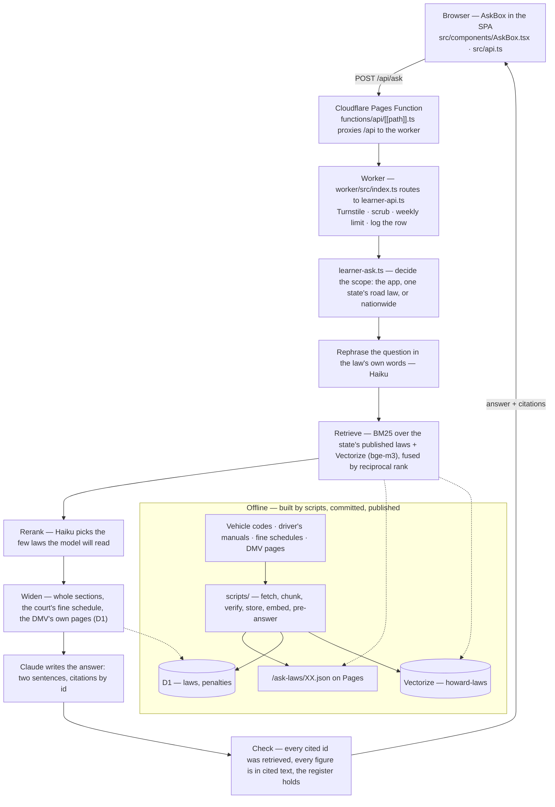

# Howard's Lantern — the ask box's RAG pipeline

The code behind the question box on [howardslantern.com](https://howardslantern.com), a permit-test app for new drivers. A learner types "what happens if I get pulled over without my license?", and the answer comes back in two sentences, written from their own state's driver's manual or vehicle code, with the page or section it rests on.

This is a reading copy, lifted from the private monorepo on 2026-10-13 with paths preserved, so every file is where its comments say it is. It holds the whole path from the browser inward — the React screen, the edge function, the worker, the retrieval pipeline, the scripts that build the corpus, the tests, the design documents — and one state, Maryland, as the sample of every resource. It is not a buildable product: the rest of the app (purchases, partners, admin), the Cloudflare bindings and every key are left out.

## The flow



## The request path, file by file

1. **`src/screens/Ask.tsx`** draws the page: the state line, the nationwide tick, the balance line, the thread, and `AskBox`. It reads the state's laws file for the sources line and merges a question code's cloud history into the kept thread (`src/ask-thread.ts`).
2. **`src/components/AskBox.tsx`** is the box itself. It holds one conversation id per box, runs the Turnstile challenge (`src/components/turnstile.ts`), keeps the thread (newest first, earlier ones folded) and the chips — one-tap questions answered from stored files, which never reach the worker.
3. **`src/api.ts`** — `askLearners` posts `{ conversation, question, turnstile, state }` to `/api/ask`, with `state: 'US'` for a nationwide question and the question code when the browser holds one.
4. **`functions/api/[[path]].ts`** — the Pages Function on the site's own origin that proxies `/api/*` to the worker, so the browser never talks to a `workers.dev` host. `functions/_middleware.ts` runs before it.
5. **`worker/src/index.ts`** — the worker's entry. The route is one `if`:

   ```ts
   if (url.pathname === '/api/ask' && request.method === 'POST') {
     return await handleLearnersAsk(request, env.DB, cors, {
       askLearner: learnerAskerFor(env.ANTHROPIC_API_KEY),
       ...
   ```
6. **`worker/src/learner-api.ts`** — the handler. Checks the Turnstile token, scrubs phone numbers and e-mail addresses out of the question before anything else sees it, applies the week's free allowance or spends a token from a question code, writes the row to `learner_questions`, and calls the pipeline.
7. **`worker/src/learner-ask.ts`** — the pipeline, below.
8. Back in the browser, `src/sources-line.ts` turns the citations into one line — *Sources: Maryland driver's manual p. 43 · as of 6 Sep 2026* — with the quoted law folded under "Show the law".

## The pipeline, step by step

Everything here is in `worker/src/`. Each module's header comment says why it exists and names the failure that shaped it; the design behind each decision is in `docs/plans/`.

**Scope.** A question is about the app, about one state's road law, about every state (nationwide), or out of scope. App questions are answered from `learner-knowledge-base.json`, a description of how the app works, with every number checked against it. Road law goes on.

**One state, one file.** A state's laws are what Pages publishes at `/ask-laws/XX.json` — the retrieval file `scripts/statutes/laws.ts` builds from the committed corpus: the manual's laws, Maryland's fifteen hand-written statutes, and the state's vehicle code cut into subsections. The worker fetches one state's file per question and never fifty-one (`/ask-laws/CA.json` alone is 7.6 MB). `docs/plans/learner-ask-law.md`, decision 1.

**Rephrase** (`law-rephrase.ts`). The learner's words are not the law's: "texting" is the codes' "electronic message". Haiku restates the question in the law's words and names, where it applies, the family of process question it belongs to (`process-families.ts`). When a question was rephrased, the candidate pool is widened to 32 laws.

**Retrieve** (`law-retrieval.ts`, `law-vectors.ts`). Two rankings over the same laws: BM25 over each law's rule and its card's question, deterministic and in the worker; and a Vectorize index, `howard-laws`, embedded with `@cf/baai/bge-m3` on Workers AI (1024 dimensions, cosine, one namespace per state), queried with the question and each of the rephraser's searches. The two are fused by reciprocal rank (k = 60). The index returns ids only; the words shown always come from the published file or the `laws` table, so a stale index can rank badly but cannot put wrong text on screen. Without the binding, or if the index or the model is down, retrieval is BM25 alone. `docs/plans/law-vectors.md`.

**Rerank** (`law-rerank.ts`). Haiku reads the pool and chooses the few laws the answering model will see, because fusing one more ranking into a pool moves laws out as well as in, and the eval showed the reranker beating any weighting of the fusion.

**Widen** (`law-nationwide.ts`, `penalty-law.ts`, `process-families.ts`). A chosen statute subsection is expanded to its whole section from the `laws` table, keyed by `(state, section)`, because a "what happens if" answer — the duty, the fine, the defence — lives across a section's subsections. Where the state's fine schedule has rows for that section (the `penalties` table, from the court's own schedule, which says what is actually paid, whether it is payable without court, and the points — figures no section of the code states), they join as cited rows. Where the rephraser named a process family — retaking a failed test, how long a permit is held, what a ticket means — the state's own DMV or court page passages for that family join by key. `docs/plans/what-happens-if.md`.

**Nationwide** (`law-topics.ts`, `law-nationwide.ts`). A question across states cannot be searched for: "which state is strictest on drunk driving" shares no word with any blood-alcohol law. So Haiku matches the question to at most two of the 35 topics every state's law has been judged on — `resource/statutes/coverage.json`, one verdict law per state per topic, chosen and checked by hand — and the model is given every state's verdict law for those topics, read from `/ask-laws/topics/<topic>.json`. Nothing is retrieved or ranked. When no topic matches, each of the 51 namespaces is queried separately and each state keeps its own best two; a state with nothing near enough is named as absent, never filled from a neighbour. If Haiku is down, the question's words choose the topic. `docs/plans/nationwide.md`.

**Answer.** One call to Claude, with the chosen laws in the user message, each with its id. The rules ask for two sentences — three for a consequence-shaped question — in a sixteen-year-old's register, no law's name or number in the prose, and citations by id. Spanish questions are answered in Spanish from the English corpus.

**Check.** Every cited id must be one of the laws the model was given; every figure in the answer must appear in cited text; the manual page shown comes from the corpus, not the model. An answer that fails is refused or sent back, never shown with a guessed citation (`docs/plans/learner-ask-law.md`, decision 4 and "How this fails silently"). `cite.ts` is the one place that decides what a citation may say.

**What the browser gets**: the answer, the citations (manual page, or statute section where the manual is silent, with the date the law was true as of), and for a nationwide answer one line per state.

## Offline: how the corpus is built

The box answers only from what the repository committed and checked. The scripts, all under `scripts/`, with their `npm run` names:

| step | script | what it writes |
|---|---|---|
| fetch a state's vehicle code, one file per section, with metadata beside them | `statutes:fetch` (`scripts/statutes/fetch.ts`) | `resource/statutes/sources/XX/*.txt`, `SOURCES.json` |
| cut each section into subsections of about a paragraph | `worker/src/code-chunks.ts` (`CHUNK_CHARS = 900`), pure, shared by the publisher, the embedder, the eval and the e2e harness | — |
| build a state's retrieval file | `scripts/statutes/laws.ts`, run by the Vite plugin at build time | `/ask-laws/XX.json` on Pages |
| write every law to D1 | `laws:store` (`scripts/laws-store.ts`) | the `laws` table (172,486 rows, every state), `resource/laws-store.json` manifest |
| embed every law | `laws:embed` (`scripts/law-vectors.ts`) | Vectorize `howard-laws`, `resource/law-vectors.json` manifest |
| read each state's fine and points schedule | `penalties:fetch` (`scripts/penalties/`) | the `penalties` table, from `resource/penalties/SOURCES.json` |
| read each state's DMV and court pages for the six process families, Haiku picking passages that are then verified as substrings of the page | `process:fetch` (`scripts/process/`) | process rows in `laws`, `resource/process/XX.json` |
| pre-answer the one-tap chips through the same pipeline | `chips:build` | `resource/chips-answers.json`, `resource/state-chips/XX.json` |
| the monthly check that every quoted section is still what the legislature serves | `statutes:refresh` | a dated report in `resource/statutes/changes/` |
| measure the box against the live model | `ask:eval:learner` (`scripts/learner-ask-eval.ts`, 190 cases) | a table in the pull request; exits non-zero on any miss |

The manifests are hashed and the unit tests recompute them, so a corpus change deployed without a store or embed push is a red test, not a nationwide answer quoting a law as it used to read.

The eval is deliberately not part of the test suite: it costs money and is not deterministic. How its golden set was built and what the harness does: [eval.md](eval.md). The worker suite (`worker/tests/`) injects a scripted model and drives everything around it in workerd; the Playwright suite (`tests/e2e/`) drives the built app with `/api/ask` stubbed at the network edge.

## What is here

```
src/                 the ask screen, the box, the API client, the thread, chips, the sources line
functions/           the Pages Functions: the /api proxy, the middleware
worker/src/          index.ts, learner-api.ts, learner-ask.ts and every module it imports; schema.sql
worker/tests/        the pipeline's tests, run in workerd with a scripted model
tests/e2e/           the ask box's Playwright specs; tests/unit/ the corpus and manifest guards
scripts/             the corpus pipeline: statutes, penalties, process pages, store, embed, chips, eval
resource/            Maryland as the sample: its sources, retrieval inputs, fine schedule, pages, chips;
                     plus the registries and manifests for every state
docs/plans/          the design documents, decision by decision
```

Not here: the rest of the app, `worker/wrangler.toml` (its bindings are `DB` D1, `LAWS` Vectorize, `AI` Workers AI, `KB` R2, `COARSE` a sibling worker; `worker/wrangler.example.toml` names them), and every key.

## Where to start reading

`worker/src/learner-ask.ts` top to bottom, following each import as it comes. Then `docs/plans/learner-ask-law.md`, `law-vectors.md`, `vehicle-code.md`, `nationwide.md` and `what-happens-if.md`, in that order — they are the pipeline's history, and each says what it tried first and why that was not enough.
