# The Ask mesh: how it actually works

The machine, in diagrams, for somebody who has to work on it. There is no
argument in this document. [ask-mcp.md](ask-mcp.md) argues for the direction and
records what it would cost; this one explains what got built.

Six services, an object store, a token format and a model interaction cannot be
held in the head from prose, and the person who most needs this is whoever picks
it up after the decisions have been forgotten.

---

## Audited 2026-09-08

Every claim below was checked against the code on the day it was written, naming
the symbol rather than a line number.
`tests/unit/mesh-architecture.test.ts` re-checks each row on every run, so a
symbol that is renamed or deleted fails the suite here rather than leaving a
document that quietly stopped being true.

| Claim | File | Symbol |
|---|---|---|
| The coarse server makes exactly one model call and none of its own to route | `mcp/coarse/mesh.ts` | `answerThroughMesh` |
| The tools of all six fine servers are declared in that one call | `mcp/coarse/mesh.ts` | `ModelRequest` |
| The model chooses the entry as well as the tool, from an enum per domain | `mcp/shared/server.ts` | `describeLookup` |
| A fine server serves one domain's object from R2, validated on the read | `mcp/shared/kb-store.ts` | `knowledgeFor` |
| The candidate set is built from the token, not filtered afterwards | `mcp/shared/kb-store.ts` | `readableBy` |
| Verification is signature, then `exp`, then `aud`, then `scope`, calling back to nobody | `mcp/shared/auth.ts` | `verifyToken` |
| Five of the six refusals are one response, on purpose | `mcp/shared/auth.ts` | `refusalResponse` |
| Only the existing worker holds a private key | `worker/src/mint.ts` | `importSignKey` |
| `read:own-money` is derived from `status === 'active'`, once | `worker/src/mint.ts` | `scopesFor` |
| The exchange narrows the audience and never extends the lifetime | `worker/src/mint.ts` | `exchangeToken` |
| A fine server is given only the scopes its own tools need | `worker/src/mint.ts` | `scopesForAudience` |
| The six domains and their prefixes are data, not code | `worker/src/kb/domains.ts` | `DOMAINS` |
| One definition of a valid knowledge base, shared by the suite and the workers | `worker/src/kb/rules.ts` | `RULES` |
| The split is a move: sections are copied as the bytes they were written in | `worker/src/kb/split.ts` | `splitKnowledgeBase` |
| Nothing is written when a rule breaks, and the refusal names the entry | `worker/src/admin-kb.ts` | `violationsAfter` |
| A write is never in place: the replaced bytes are archived first | `worker/src/admin-kb.ts` | `archiveKeyFor` |
| The scheduled re-validation catches a constant that moved under an answer | `worker/src/kb-cron.ts` | `runKnowledgeCheck` |
| It runs from its own worker, so the partner worker keeps having no cron | `mcp/cron/index.ts` | `CronEnv` |
| The mesh is off unless `ASK_VIA_MESH` says otherwise | `worker/src/mesh-ask.ts` | `meshEnabled` |
| Placeholders are filled in the worker that holds the row, never in the mesh | `worker/src/ask.ts` | `fill` |
| A citation is never shown as a repository path | `worker/src/cite.ts` | `citeFor` |

### What the spike settled, before anything was built on it

Four claims would have changed the design if false. Each was driven in workerd
first.

| Claim | Answer |
|---|---|
| `createMcpHandler` serves stateless Streamable HTTP with no Durable Object | **True.** `McpAgent` is deprecated for new servers; six fine servers are six plain Workers. |
| A Worker can act as an MCP *client* | **True**, through `StreamableHTTPClientTransport` with an injected `fetch`. The Agents SDK's own `MCPClientManager` needs a Durable Object and was not used. The hand-written JSON-RPC fallback was not needed. |
| Workers' Web Crypto signs and verifies Ed25519 from a Worker secret | **True** from PKCS8 and from JWK. **Raw private-key import is refused**, with an error naming the wrong problem: *"Attempt to import public Ed25519 key with invalid usage sign"*. |
| The mesh is drivable in `vitest-pool-workers` with R2 bound | **True**, by importing each Worker's own handler and driving it over `Request`/`Response` in the same isolate. Auxiliary workers would need pre-built bundles, which would put a build step between the source and the test. |

---

## 1. The router, and where it does *not* make a model call

The part this document exists for. Every question in the thread that produced
this design was really about this layer: whether it routes or aggregates,
whether it costs one model call or two, whether picking one domain loses the
cross-domain answers.

The two-tool case is on the diagram deliberately. A single-tool sequence would
make the whole argument invisible.

**There is no bot on this diagram, and that is the point.** From outside, the
feature is conversational -- somebody types a question and reads an answer --
so "the bot" is the natural name for it and the one everybody reaches for.
Drawn from the inside there is nothing to give that name to. `Claude` appears
once, is handed the tool list, and returns which tools to call; every arrow
after it carries a `verbatim entry`. The model chooses *which* written answer
is shown and never composes a word of one. `ask box` below is the input on the
partner page, not a participant that speaks.

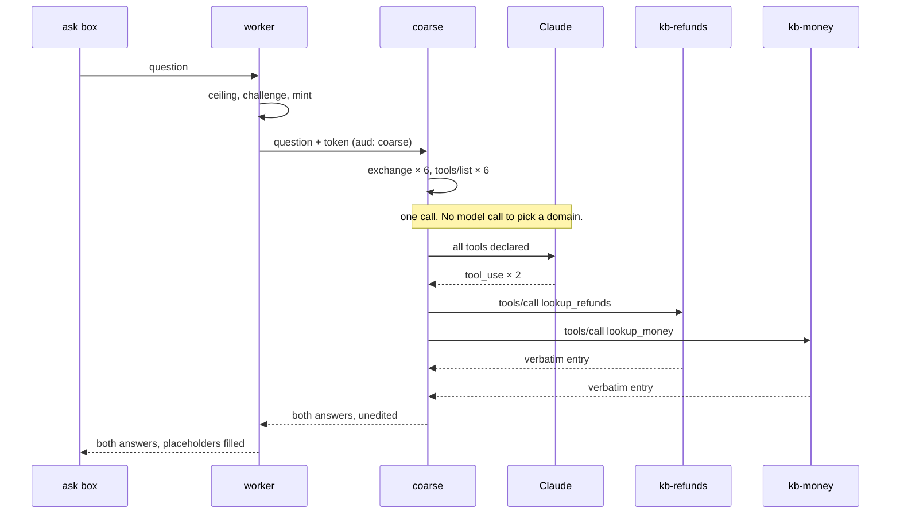

**Where the entry is chosen.** `describeLookup` puts each domain's entry ids and
their advertised phrasings into the tool description, and the tool's `entry`
argument is an enum of exactly those ids. So the model picks the tool *and* the
entry in the same call — which is why there is one model call and not two, and
why §2 of [ask-mcp.md](ask-mcp.md) costs a shape that was not built.

**Where nothing is composed.** The tool results are never sent back to the
model. There is no second turn on which it could write a sentence about
somebody's money, and the answer the asker reads is the entry, byte for byte.
The compose rule is still stated in the system prompt and in every tool
description; stating a rule to a model that is then never given the opportunity
is the safe ordering of those two facts, not a redundant one.

## 2. The request path, anonymous and signed in

The same two routes, the same box, the same challenge. What differs is which
tools exist.

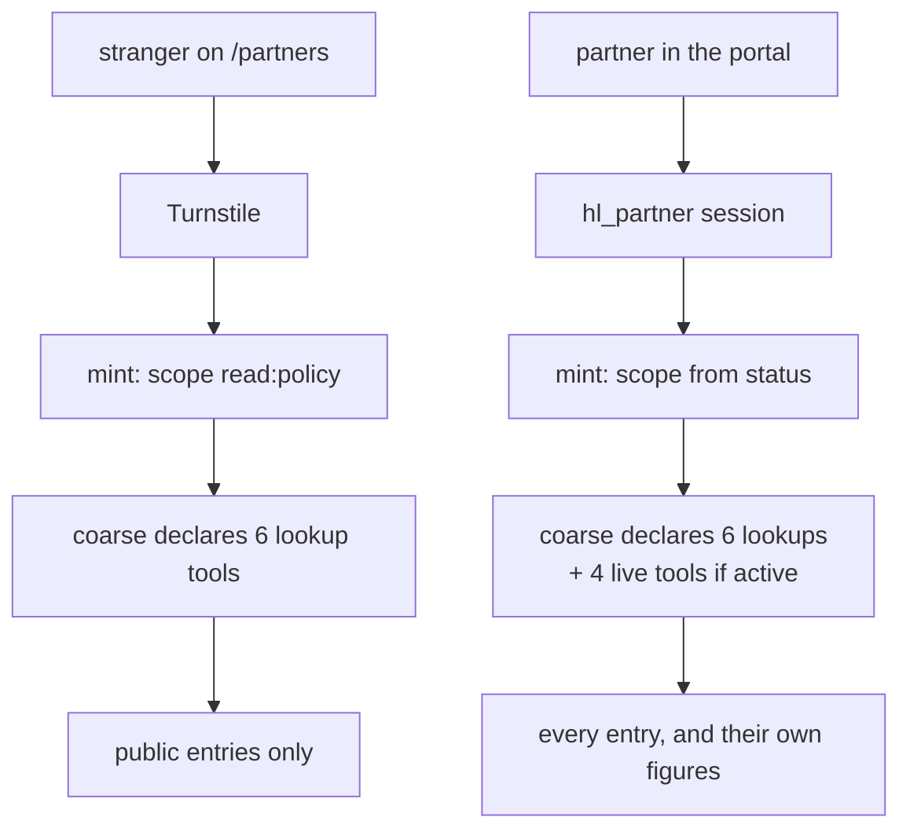

An anonymous asker has no `payout_status` in their tool list to call, and a
forged call to one is refused by the fine server anyway. Two independent noes,
neither resting on the other.

## 3. The domain map

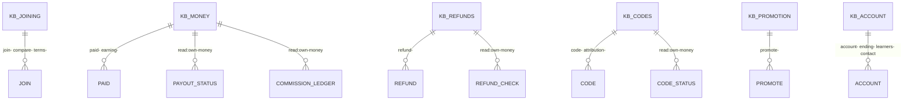

23 joining, 13 money, 12 account, 11 refunds, 7 codes, 6 promotion — computed
from the file, not copied from §3 of [ask-mcp.md](ask-mcp.md), whose table
totals 67 against a corpus of 72 and is wrong in four of its six rows.

An entry belongs to exactly one server: the domain whose *question* it answers,
not every domain it mentions. Cross-domain reach comes from the model calling
two tools.

---

# Authentication and authorization

Not one diagram among six. It is the part with the most moving pieces, the
fewest visible symptoms when wrong, and the only part where a mistake exposes
one partner's money to another.

Two properties to state in words, because a diagram cannot carry them:

- **Only one service can mint a token.** `learners-permit-api` holds the private
  key as a Worker secret. The seven mesh workers hold the public half in their
  configuration and can verify without being able to issue.
- **The model never sees a token.** It names a tool; the coarse server attaches
  credentials afterwards. A design where a token could reach the model's context
  is a design where a prompt injection can exfiltrate one.

## 4. Where identity comes from

Three origins that are easy to conflate. Each produces a different principal and
each is checked by different code.

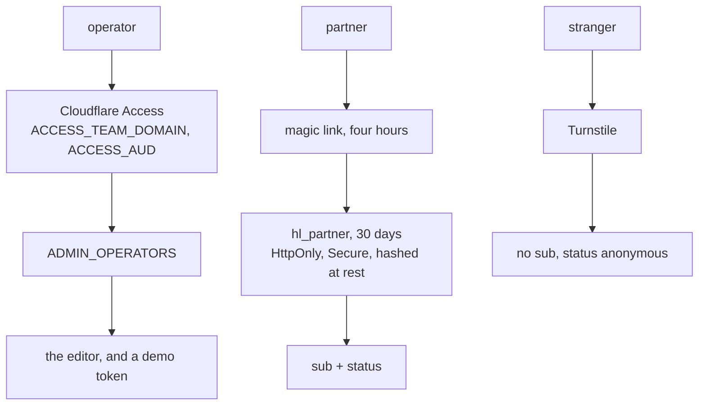

## 5. The mint

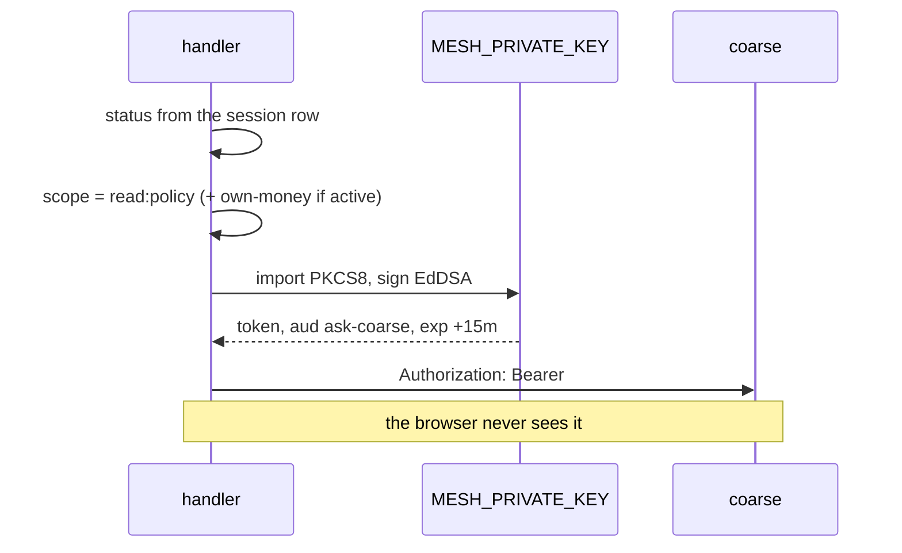

## 6. Token passing, and the exchange — the centrepiece

The coarse server does not forward the token it was given. Before each tool call
it presents its own and asks for one audienced to *that fine server only*.

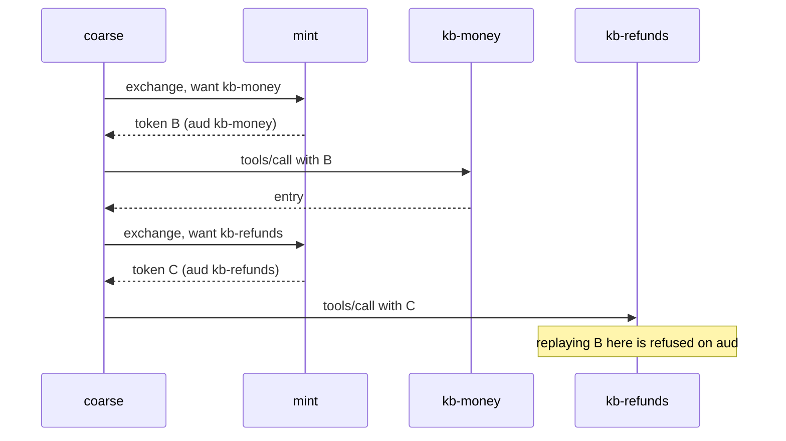

**What pass-through would cost.** One fewer hop, and every fine server would
hold a credential that works against all of the others: a bug in
`kb-promotion` — the server with no live data and the least reason to be
hardened — would yield a token that opens `kb-money`. The exchange is what makes
six services six blast radii instead of one. A reader who cannot see why the
second token exists will delete it.

## 7. Verification at a fine server

Four checks, in this order, and **no step calls back to anybody**. That
independence is the whole reason for claims and it is invisible in prose.

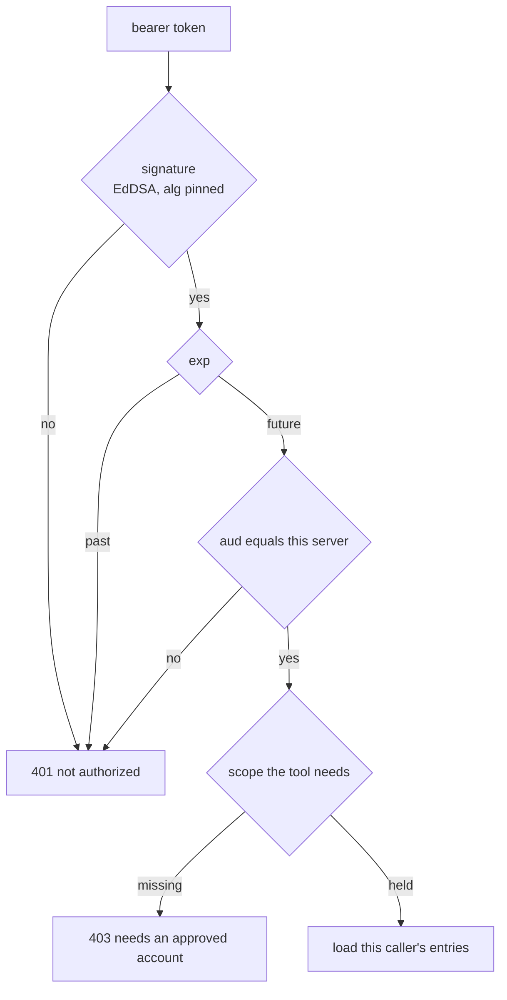

The order is not cosmetic. Every check after the first reads a claim, and
reading a claim out of a token whose signature has not been checked is reading a
string an attacker wrote. `alg` is pinned rather than read: `alg: none` and an
HMAC signed with the public key are the two classic ways a token verifies
against a key it was never signed with, and both begin with trusting that field.

## 8. Authorization, as a table

Beside the diagram rather than inside it. A reader should be able to answer
"could an anonymous visitor reach `payout_status`" by looking.

| Tool | Server | Requires | Declared to an anonymous asker? |
|---|---|---|---|
| `lookup_joining` | kb-joining | `read:policy` | yes, public entries only |
| `lookup_money` | kb-money | `read:policy` | yes, public entries only |
| `lookup_refunds` | kb-refunds | `read:policy` | yes, public entries only |
| `lookup_codes` | kb-codes | `read:policy` | yes, public entries only |
| `lookup_promotion` | kb-promotion | `read:policy` | yes, public entries only |
| `lookup_account` | kb-account | `read:policy` | yes, public entries only |
| `payout_status` | kb-money | `read:own-money` | **no** |
| `commission_ledger` | kb-money | `read:own-money` | **no** |
| `refund_check` | kb-refunds | `read:own-money` | **no** |
| `code_status` | kb-codes | `read:own-money` | **no** |

The entries-by-audience rule is the same kind of check: an entry not marked
`Audience: anyone` is absent from the enum a `read:policy` token is offered, and
`lookup_*` resolves an id against that same list a second time.

## 9. The auth failure paths, and which are indistinguishable on purpose

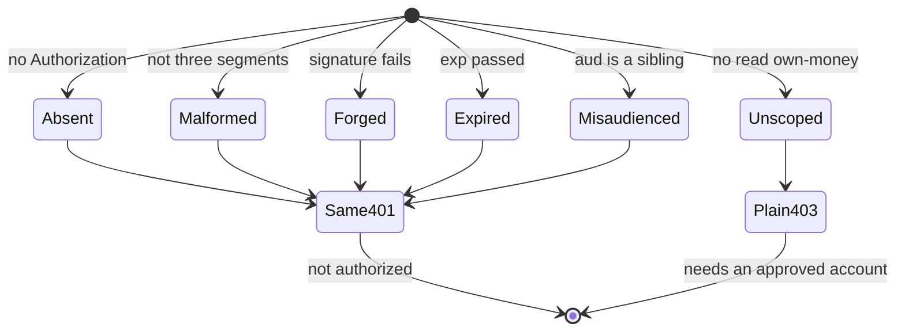

**The first five are the same response, byte for byte.** Telling somebody "that
token is valid but audienced elsewhere" confirms the signature, the lifetime and
the shape, and names which server it does open. `scope` is answered plainly
because the holder of a good token has to be able to tell "I am not approved
yet" from "my token expired", and neither answer helps anybody who does not
already hold a valid token.

Turnstile unsolved and Access absent are refused before a token exists at all —
at `/api/partner/ask` and at `/api/admin/*` respectively — so neither reaches
this diagram.

## 10. The revocation window

A deliberate hole, and a picture of it is the only form anybody will remember.

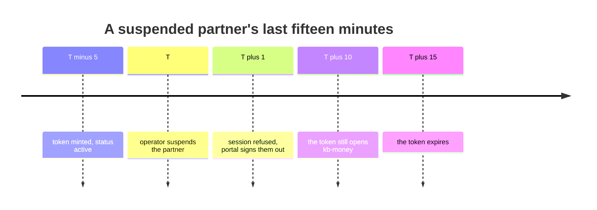

A fine server that checked a revocation list on every call would need a shared
store and a network hop, which is most of what the claims design exists to
avoid. Fifteen minutes of stale authority on read-only tools is the trade.
**The day a tool in this mesh mutates anything, this decision has to be
re-taken** — that is the note for whoever adds one.

---

## 11. The knowledge lifecycle

The write gate and the cron catch different failures, and a diagram that showed
one of them would be worse than none.

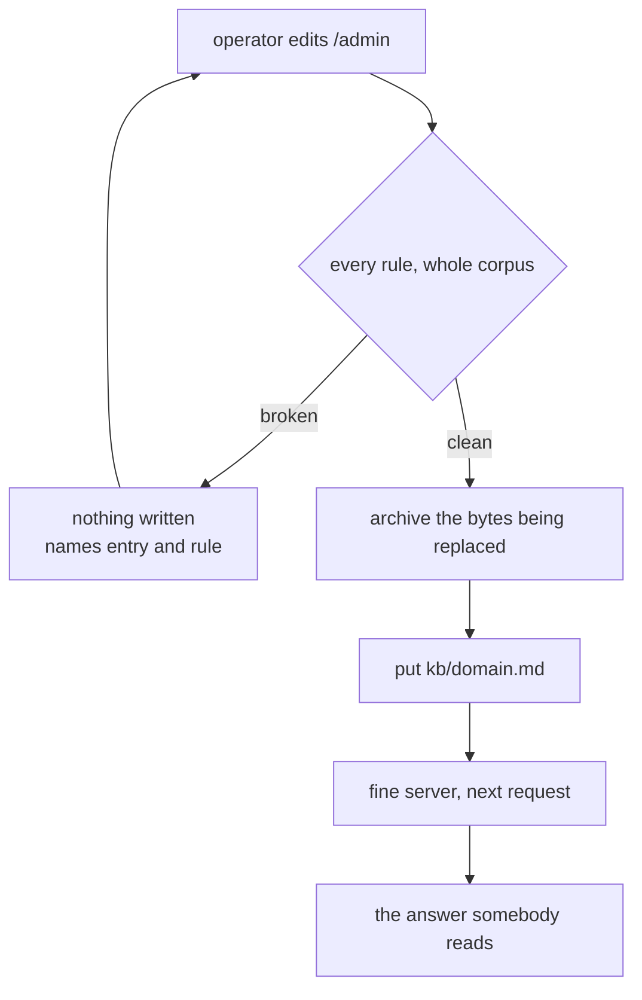

The cron is a separate loop, and it catches the failure the gate cannot see: the
object was correct when written and the **code moved underneath it**.

**The cron is its own worker, `kb-cron`, and not a `scheduled` handler on
`learners-permit-api`.** That worker has no cron trigger and no scheduled
handler at all, and `tests/unit/partner-schema.test.ts` asserts it under
"nothing extends a partner code except somebody deciding to": a cron that
renewed every code on a schedule would be a helpful-looking change that restored
the liability tail a twelve-month term was added to end, and it would pass every
behavioural test here because renewed codes work. One more deploy is cheaper
than loosening that.

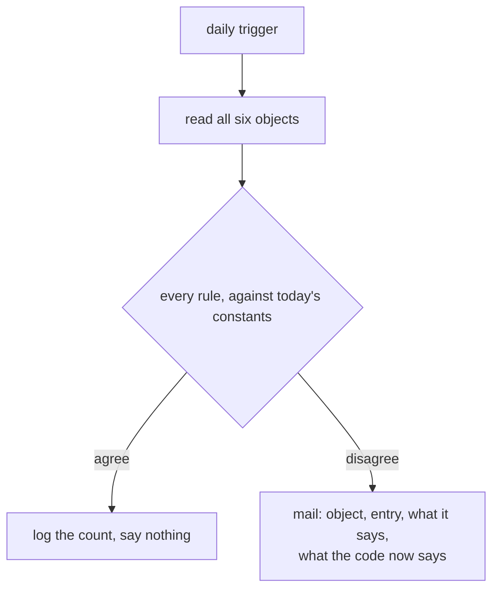

`LINK_TTL_SECONDS` going from four hours to one would silently falsify a
published answer with no edit involved and nothing failing. That is precisely
the class of defect this repository has already shipped.

## 12. The failure paths

Where each lands, and what the asker sees. This is the half a happy-path diagram
omits, and where this repository's shipped defects have actually lived.

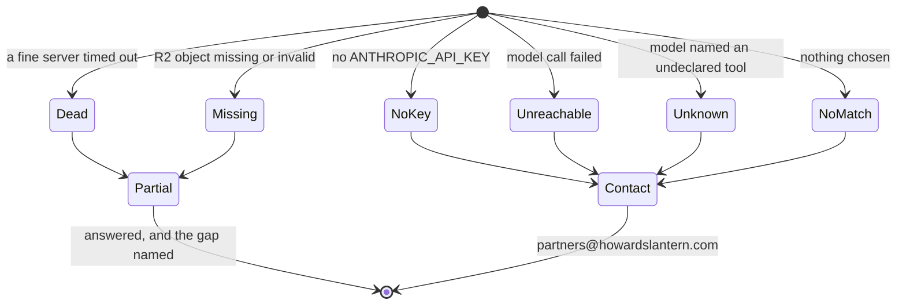

Every one of them is an HTTP 200. A refusal a person can act on is the floor,
and an error page is not one.

---

## 13. Deploying this, which nothing in the repository can do

Account actions, in order. None of them can be taken by a build pipeline and
none of them should be taken out of order.

1. **Create the bucket.**
   `npx wrangler r2 bucket create learners-permit-kb`
2. **Generate the key pair.** `npm run mesh:key` prints both halves.
3. **Install the signing half**, on one service only:
   `npx wrangler secret put MESH_PRIVATE_KEY --config worker/wrangler.toml`
4. **Install the verifying half** as `MESH_PUBLIC_KEY` in all seven mesh
   configs: `mcp/fine/*/wrangler.toml` and `mcp/coarse/wrangler.toml`.
5. **Seed the six objects.** `npm run kb:push -- --push`
6. **Record the eval baseline** against the *old* router, before any of this is
   switched on: `npm run ask:eval -- --record`, and commit the file. It is the
   only before-number there will be.
7. **Deploy the eight, then the worker.** `npm run mesh:deploy` does them in the
   order the service bindings require: six fine servers, the coarse aggregator,
   `kb-cron`, and `learners-permit-api` last.
8. **Uncomment the two runbook-gated bindings** in `worker/wrangler.toml` — the
   `COARSE` service binding and the `[[r2_buckets]] KB` block — and deploy the
   worker again. Both name resources that do not exist until steps 1 and 7 have
   been taken, and the Workers API refuses a script bound to a bucket or a
   service that is not there, so either of them left uncommented would make
   `npx wrangler deploy --config worker/wrangler.toml` fail — for this change
   and for every unrelated worker change after it. `wrangler deploy --dry-run`
   never contacts the API and is not evidence either way. Until this step the
   editor at `/admin` answers 503 and logs `admin-kb: no KB bucket is bound`.
9. **Turn it on.** Set `ASK_VIA_MESH = "1"` and deploy. Unsetting it is the
   whole of the rollback.

Nothing between steps 1 and 8 changes what a visitor sees.

**Before step 9**, settle the two things the adjudication left open: how a live
tool's figures are rendered to a partner (`payableCents: 2000` is what they read
today), and whether an entry *added* through the editor should reach an asker
before the next deploy. Both are in `docs/work/ask-mcp-mesh/verdict.md`, and
both are cheaper to decide with the flag still off.

## 14. Showing it working

The demo, in the order that makes the argument.

**Connect a third-party MCP client to one fine server.** Mint a read-only token
from the operator screen — `POST /api/admin/mesh-token` with
`{"audience":"kb-money"}` — and point any MCP client at
`https://kb-money.<account>.workers.dev/mcp` with
`Authorization: Bearer <token>`. `initialize`, `tools/list` and `tools/call` all
answer. Locally, `npm run mesh:dev` serves the same thing on
`http://127.0.0.1:8802/mcp` with no Cloudflare account at all.

**The two-tool answer.** Ask *"what if a refund comes after you've paid me"*.
Two `lookup_*` calls, two written answers, one model call. This is the case the
whole aggregate-don't-route decision exists for.

**A live figure.** Signed in as an approved partner, ask *"why haven't I been
paid"*. `payout_status` returns the blockers that actually apply — the amount
short of the floor, a hold from changed details — rather than the six
conditions.

**An edit taking effect with no deploy.** Change a sentence on the *answers* tab
at `/admin`, save, and ask the question again. A fine server holds a good read
for 30 seconds (`KB_CACHE_SECONDS`), so on a warm isolate the change is live
within half a minute rather than on the very next request — worth knowing
before you ask twice and conclude the save did not take.

**A refused bad edit.** Put `{payable}` into an entry marked
`Audience: anyone` and save. Nothing is written, and the screen names the entry
and the rule.

**A replayed token.** Take a token minted for `kb-money` and present it to
`kb-refunds`. `401 not authorized`, on `aud` — and the same 401 a forged,
expired or absent token gets.

## 15. The alternative that was rejected, and is better for most teams

**One Worker serving six `createMcpHandler` instances at six paths.** By the
protocol that is six MCP servers. It is one deploy, one set of secrets, one
thing to watch, and much less ceremony.

It was rejected here because it throws away the property being demonstrated: six
separate Workers means six sets of secrets and six blast radii, and the token
exchange has something real to protect. At 72 entries with one owner and no
outside clients, the single worker is the better answer, and
[ask-mcp.md](ask-mcp.md) §10 records the three things that flip it — outside
clients, many domains with different owners, and live data.

Saying so is the point. An over-built system whose author names the
disproportion reads as judgment; the same system defended as necessary reads as
naivety.
