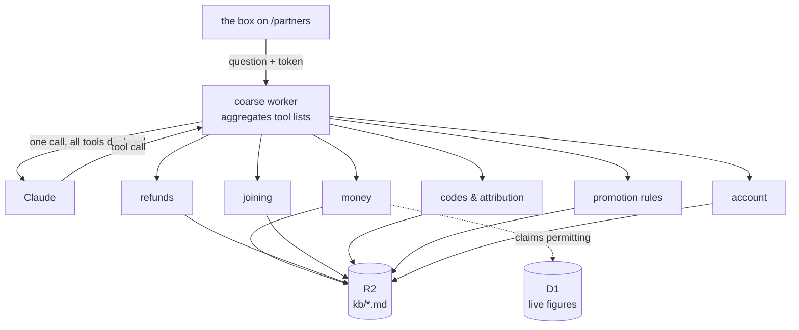

# A tool mesh for Ask: coarse server, fine servers, editable knowledge

Written 2026-09-08, describing the architecture asked for in the words it was
asked in:

> bot => coarse grain mcp server => fine grain mcp servers, where the coarse
> grain mcp server accepts natural language queries and is configured to know
> about the fine grained servers. The coarse grained server creates a tool list
> for the LLM. Each fine grained server uses a knowledge base that is simply a
> file that is stored in a cloudflare object that can be written to and read
> directly from a markdown editor...and auth is handled using tokens and claims

> each coarse grain client can have a single responsibility such as answering
> questions related to payouts or refunds or other things

This is the successor to [partner-ask.md](partner-ask.md), whose implementation
is open as PR #206 and is not yet deployed. **It does not replace that work; it
re-hosts it.** The 72 written answers are the payload either way — what changes
is where they live, who may edit them, and what else the bot can reach.

---

## 1. The shape, and the one decision that makes it cheap



**The coarse server aggregates and declares; it does not route.** This is the
whole difference between an architecture that costs one model call and one that
costs two or three. It collects the fine servers' tool descriptions, hands the
model *all* of them in a single request, and forwards whichever tool the model
picks. It never makes a model call of its own to decide which fine server is
relevant.

That matters beyond cost. A router that picks one domain gets
`refund-after-payment` wrong — "what if a refund comes after you've paid me" is
a refunds question and a money question, and it is the single entry most likely
to decide whether somebody signs up. When every tool is declared at once, the
model can call two and the domain split stops needing to be perfect.

## 2. Why the split is worth having

Not for the prompt size, at today's scale. Worth being exact about this because
it is the argument that decides when to build it.

| | today (PR #206) | this mesh |
|---|---|---|
| Model calls per question | **1** | **2** — pick a domain tool, then pick an entry from what it returns |
| Prompt on call 1 | all 72 entries, ~10K tokens | six tool descriptions, ~1K |
| Prompt on call 2 | — | one domain's ~12 entries, ~2K |

**At 72 entries this is a wash or slightly worse.** Two round trips against one,
for a total token count that is not much lower. It becomes clearly better at
several hundred entries across a dozen domains, where putting everything in one
prompt stops being possible and the flat enum stops being reliable.

So the reasons to build it now are the other three, and they are real:

- **Single responsibility per domain**, with its own file, its own owner, and
  its own release cadence.
- **The knowledge is editable without a deploy** — §4.
- **It is the shape that admits live data**, which written answers cannot
  provide at all — §6. This is the capability that does not exist today in any
  form.

## 3. The six fine servers

Each is a Cloudflare Worker exposing MCP over Streamable HTTP. The domains fall
out of the entry-id prefixes that already exist in
`worker/src/knowledge-base.md`, so the split is a move rather than a
reclassification:

| Server | Entries from | Roughly |
|---|---|---|
| `kb-joining` | `join-*`, `compare-*`, `terms-*` | 22 |
| `kb-money` | `paid-*`, `earning-*` | 10 |
| `kb-refunds` | `refund-*` | 8 |
| `kb-codes` | `code-*`, `attribution-*` | 8 |
| `kb-promotion` | `promote-*` | 7 |
| `kb-account` | `account-*`, `ending-*`, `learners-*`, `contact` | 12 |

Each exposes one tool at minimum:

```
lookup_<domain>(question: string) -> { id, answer, cite, audience }
```

The answer is returned **verbatim from the file**. A fine server never
paraphrases, and the coarse server never edits what it forwards. That property
is the reason the current design is safe to put in front of somebody who has
not signed anything, and it survives this move unchanged or the move is not
worth making.

**An entry belongs to exactly one server** — the domain whose *question* it
answers, not every domain it mentions. `refund-after-payment` is a refunds
entry that cites the clearing window. Cross-domain reach comes from the model
calling two tools, not from filing an entry twice.

## 4. Knowledge in R2, edited directly

One object per domain — `kb/joining.md`, `kb/money.md`, and so on — in a single
bucket, in the same markdown format the file already uses (`## <id>`,
`**Asks:**`, `**Audience:**`, answer, citation).

The editor is an admin surface behind the Cloudflare Access application that
already fronts `/admin`, so it needs no new identity system:
`ADMIN_OPERATORS` and `ACCESS_AUD` in `worker/wrangler.toml` already say who may
reach it.

**R2 object versioning is on, and a write is never in place.** A bad edit has to
be recoverable in one action, and "the previous text" is not something anybody
will have kept a copy of.

### The gate that makes this safe, and is the whole of the risk

Editing in production skips `npm test`. Today the suite holds eleven things
true about these files — no public entry carries a placeholder, every entry
agrees with the worker constant it cites, every `§N` resolves to a heading in
the agreement, ids are unique, answers survive rendering byte for byte. **Move
the files to R2 and every one of those guarantees is gone unless it is
rebuilt.** That is not a reason to reject the design; it is the design's
central requirement, and skipping it is how a partner ends up reading a
confident sentence about their money that stopped being true four deploys ago.

Two mechanisms, and both are needed because they catch different failures:

**A write-time gate.** The editor's save path runs the same checks as
assertions before the object is written, and refuses with the reason. This
catches a bad *edit*.

**A scheduled re-validation.** A cron worker re-runs every check against the
current deployed constants and alerts on a mismatch. This catches the failure a
write-time gate cannot see: the file was correct when written and the *code*
moved underneath it. `LINK_TTL_SECONDS` going from four hours to one would
silently falsify a published answer with no edit involved and nothing failing —
which is precisely the class of defect this repository has actually shipped.

The checks themselves already exist as `tests/unit/knowledge-base.test.ts` and
should be lifted into a module both the suite and the workers import, so there
is one definition of "valid" rather than two that drift.

## 5. Auth: tokens and claims

A short-lived signed token, minted by the existing worker, verified
independently by each fine server. The point of claims here is that a fine
server never calls back to ask who somebody is — it reads the token and decides.

| Claim | Meaning |
|---|---|
| `sub` | partner id, or absent for an anonymous visitor |
| `status` | `pending` / `active` / `suspended` |
| `scope` | `read:policy`, and `read:own-money` only for an active partner |
| `aud` | which fine servers this token is good for |
| `exp` | 15 minutes |

- **Anonymous:** minted after a Turnstile solve. `scope: ["read:policy"]`. Every
  fine server serves it only entries marked `Audience: anyone`.
- **Signed in:** minted from the existing `hl_partner` session, which is already
  an HttpOnly, Secure, hashed-at-rest cookie. Carries `sub` and, **for an
  `active` partner only**, `read:own-money`.

That last condition fixes something currently open: `partnerFromSession` accepts
`pending`, so anyone who can receive email has a session minutes after applying,
before an operator has looked. Deriving `read:own-money` from `status === 'active'`
makes approval mean something at the token layer rather than relying on each
handler to remember.

### Three decisions this design has to make explicitly

Each is a fork, and picking by default rather than on purpose is how auth goes
wrong quietly.

**Asymmetric, so only one service can mint.** The token is signed EdDSA by the
existing worker, which holds the private key as a Worker secret; the six fine
servers hold only the public key and can verify without being able to issue.
The symmetric alternative puts a minting key in seven places, and a leak from
the least-guarded of them mints tokens for all of them. The public key ships in
the fine servers' config, so rotation is a deploy rather than a secret
distribution.

**Exchange at the coarse server, not pass-through.** The caller's token is
audienced to the coarse server alone. Before forwarding a tool call, the coarse
server exchanges it for a token audienced to *that fine server only*, with the
scopes that server needs and nothing more. Pass-through is one fewer step and
gives every fine server a credential that works against all of the others — so
a bug in `kb-promotion`, the server with no live data and the least reason to be
hardened, yields a token that opens `kb-money`. The exchange is what makes six
services six blast radii instead of one.

**Revocation is a lifetime decision, and 15 minutes is the answer.** A suspended
partner holds a valid token until it expires; a fine server that checked a
revocation list on every call would need a shared store and a network hop, which
is most of what the claims design exists to avoid. Fifteen minutes of stale
authority on read-only tools is the trade, and it is only defensible because
none of these tools writes anything. **The day a tool mutates, this decision has
to be re-taken** — that is the note to leave for whoever adds one.

**The audience split moves up a level and gets stronger.** Today the public
route is a separate handler holding a separate list. Here, an anonymous token
means the coarse server does not *declare* the live tools at all — a stranger
has no `payout_status` in their tool list to call, and would still be refused by
the fine server if they forged one. Two independent refusals, neither relying
on the other.

## 6. What this buys that written answers cannot

The capability that justifies the whole exercise. Alongside each `lookup_*`
tool, the servers whose domains have live data expose real queries, gated on
`read:own-money`:

| Server | Tool | Backed by |
|---|---|---|
| `kb-money` | `payout_status()` | `payoutBlockers`, `summaryFor` — already written |
| `kb-money` | `commission_ledger(range)` | `ledgerFor` — already written |
| `kb-refunds` | `refund_check(code)` | `refund-admin.ts` — already written |
| `kb-codes` | `code_status()` | `describePartner` — already written |

So "why wasn't I paid this month" stops being *the six conditions that gate a
payment* and becomes *you are $12.80 short of the floor and your details changed
four days ago, so the next run is the one after this*. The queries exist; none
of this needs new data.

**And a rule that has to survive:** the model may compose **numbers** returned
by a live tool. It may never compose **terms**. Policy answers keep coming back
as a verbatim entry from a `lookup_*` tool, because a sentence about what a
refund does to a commission is a representation about money and is not something
to regenerate per request. This is the line the whole design rests on and it is
worth stating in the coarse server's system prompt, in each fine server's tool
description, and in a test.

## 7. Migration from PR #206

Deliberately not a rewrite. In order, each step shippable alone:

1. **Merge and deploy #206.** It is the payload. Nothing below is testable
   against a knowledge base nobody has ever queried.
2. **Run `npm run ask:eval` once** and record the number. It is the only
   baseline that will exist, and every step after this makes routing harder —
   two calls instead of one, tool descriptions instead of an enum. Without a
   before-number, a drop in accuracy is unattributable.
3. **Lift the validation checks into a shared module**, imported by both the
   suite and (later) the workers.
4. **Write `docs/plans/ask-mcp-architecture.md`** — §8. Before the split, not
   after: its job is to be the thing steps 5 to 8 are built against, and a
   diagram drawn after the fact documents whatever got built rather than what
   was meant.
5. **Split the file into six R2 objects** and stand up the fine servers, still
   serving the same verbatim answers. No behaviour change; the e2e suite from
   #206 should pass untouched, which is the test of whether this step was
   clean.
6. **Stand up the coarse server and the token mint.** Switch the box to it.
7. **The editor, with the write-time gate and the cron re-validation together.**
   Never the editor first.
8. **Live tools**, one at a time, `payout_status` first — it answers the
   question the portal already exists to answer.

## 8. The design document this work owes

**`docs/plans/ask-mcp-architecture.md`, written before any of §7 step 5 is
implemented**, and re-checked against deployed code once the mesh is live.

Not a duplicate of this file. This one argues for a direction and records what
it would cost; that one explains the machine to somebody who has to work on it,
in diagrams, with no argument in it. Six services, an object store, a token
format and a two-call model interaction cannot be held in the head from prose,
and the person who most needs it is whoever picks this up after the decisions
have been forgotten.

**The router is the part it exists for.** Every question in this thread was
really about that layer — whether it routes or aggregates, whether it costs one
model call or two, whether picking one domain loses the cross-domain answers.
That is exactly the thing a paragraph explains badly and a sequence diagram
explains completely, and the version that ends up in the code will be the one
future readers assume was obvious. It was not.

Required, each as a mermaid diagram with prose naming the file and symbol that
proves it:

- **The router, in full, as a `sequenceDiagram`.** Both model calls, explicitly:
  the first carrying six tool descriptions and returning a tool choice, the
  second carrying one domain's entries and returning an id. Where the coarse
  server aggregates, where it forwards, and — stated, because its absence is the
  design — **where it does not make a model call of its own**. The two-tool case
  must be on the diagram, since a single-tool sequence would make the whole
  cross-domain argument invisible.
- **The request path end to end**, anonymous and signed-in as a before/after
  pair, from the box to the answer, showing which tools are declared in each
  case.
### Authentication and authorization get their own chapter

Not one diagram among six. It is the part with the most moving pieces, the
fewest visible symptoms when wrong, and the only part where a mistake exposes
one partner's money to another. It needs, at minimum:

- **Where identity comes from, as a `flowchart`.** Three separate origins that
  are easy to conflate: **Cloudflare Access** in front of the editor (the
  existing application, `ACCESS_TEAM_DOMAIN` and `ACCESS_AUD`, an operator from
  `ADMIN_OPERATORS`); the **partner magic-link session** (`hl_partner`,
  HttpOnly, Secure, hashed at rest, four-hour link, thirty-day session); and
  **Turnstile** for somebody with no account at all. Each produces a different
  principal and each is checked by different code.
- **The mint, as a `sequenceDiagram`.** Which service signs, with what key,
  what goes in the claims, and what the lifetime is — including where the
  private key lives and why exactly one service has it.
- **Token passing across the hops, as a `sequenceDiagram`, and it is the
  centrepiece.** Browser → coarse → fine, showing the **exchange**: the token
  arriving audienced to the coarse server, and a *different* token, audienced
  and scoped to one fine server, going out. Draw the pass-through alternative
  beside it and mark what it would cost, because the diagram is the argument —
  a reader who cannot see why the second token exists will delete it.
- **Verification at a fine server, as a `flowchart`:** signature, `exp`, `aud`,
  then `scope`, in that order, and the fact that **no step calls back to
  anybody**. That independence is the whole reason for claims and it is
  invisible in prose.
- **Authorization as a table beside the diagram**, not inside it: every tool
  against the claim it requires, with the entries-by-audience rule stated as the
  same kind of check. A reader should be able to answer "could an anonymous
  visitor reach `payout_status`" by looking, and see the two independent noes —
  the tool is never declared to them, and the fine server would refuse it
  anyway.
- **The auth failure paths, as a `stateDiagram-v2`:** absent token, malformed,
  bad signature, expired, wrong `aud` (a token for `kb-money` replayed at
  `kb-refunds`), missing scope, `status` no longer `active`, Turnstile
  unsolved, Access absent on the editor. What each returns, and — the part that
  matters — **which of them are indistinguishable to the caller on purpose**.
- **The revocation window, drawn as a timeline.** Suspension at T, token issued
  at T−5 minutes, access surviving to T+10. It is a deliberate hole and a
  picture of it is the only form anybody will remember.

Two properties to state in words beside the diagrams, because a diagram cannot
carry them: **only one service can mint a token**, and **the model never sees a
token** — it names a tool, and the coarse server attaches credentials. A design
where a token could reach the model's context is a design where a prompt
injection can exfiltrate one.
- **The knowledge lifecycle, as a `flowchart`:** editor → write gate → R2 object
  → fine server → answer, with the cron re-validation drawn as the separate
  loop it is. The two gates catch different failures and a diagram that shows
  one of them is worse than none.
- **The failure paths, as a `stateDiagram-v2`:** no token, expired token, wrong
  claim, tool not declared, fine server unreachable, R2 object missing or
  invalid, model returns an unknown id, nothing matched. Where each lands and
  what the asker sees. This is the half a happy-path diagram omits, and where
  this repository's shipped defects have actually lived.
- **The domain map, as an `erDiagram`:** the six servers, their entry prefixes,
  which hold live tools, and which claim each live tool requires.

Two rules it is held to. **Roughly a dozen nodes per diagram** — past that, split
it; an unreadable diagram is worse than none. And **every claim in it is checked
against deployed code on the day it is written**, naming the symbol rather than
a line number, with a dated audit line at the top the way
[partners-v2.md](partners-v2.md) carries — because the failure mode of an
architecture document is not being wrong on the day it is written, it is staying
on disk after it stops being true.

## 9. What to verify before committing to this

Claims that would change the design if false, and none of them is settled here:

- **MCP on Workers.** Remote MCP servers on Cloudflare are supported, and the
  transport and hosting details (Durable Objects backing, Streamable HTTP versus
  SSE, whether an MCP client is available to a Worker acting as one) need
  checking against current Cloudflare documentation rather than recalled.
- **Whether the coarse layer needs MCP at all.** MCP is a transport for tool
  definitions owned by somebody else. If all six fine servers are yours and
  deploy together, the same aggregation is a function call and the mesh is six
  modules rather than six services. **MCP earns its place the day a client you
  do not control needs in** — Claude Desktop, a partner's own agent, a buyer's
  diligence tooling. Worth deciding deliberately rather than by momentum,
  because six workers cost six deploys and six sets of secrets.
- **Two model calls per question**, against one today. Measure it; §2 says it is
  roughly a wash at 72 entries and a clear win at several hundred.
- **The cost ceiling has to move with the architecture.** #206 bounds the public
  route at 300 questions a day. Two calls per question makes the same ceiling
  twice the money, and the ceiling now has to be enforced at the coarse server
  because that is the only place that sees a whole question.

## 10. When this is the wrong shape

Recorded so the decision can be re-taken rather than re-argued.

If the knowledge base stays around 72 entries, one owner edits it, and no
outside client ever calls in, then the mesh is six services and an object store
doing what one file and a function already do — and it costs the eleven
compile-time guarantees, which have to be rebuilt at runtime to get back to
where PR #206 already is.

The three things that flip it: **outside clients**, **many domains with
different owners**, or **live data** — and the third is available on its own,
today, by adding tools to the single worker without splitting anything.
