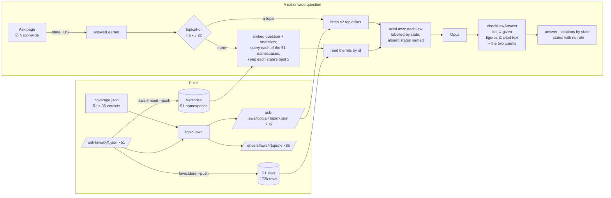

# Nationwide: one question, every state's law, and search told the site compares them

branch: nationwide
slug: nationwide

> **2026-10-09:** phase 1 shipped in #769 (deployed as deploy/20261009-2336).
> Phase 2 — section F, criteria 16–22, guards 15–21 — is built on branch
> `nationwide-2`; its PR records what was pushed, measured and changed.

Written 2026-10-09, revised the same evening. Joel's brief, given while the
ask-rephrase branch (#767) was being measured: a **Nationwide** checkbox on
the ask page that scopes a question across all the states — *which state has
the strictest drunk driving laws* — with the number of laws the model is given
raised to whatever that needs, and the site's search presence updated to
advertise a thing no competitor has. His expectation, settled in the same
conversation: the state path stays exactly as it is, with its namespace per
state, and a nationwide question runs against every state's laws — not only
the topics the site has judged. "Do what makes sense to you."

So it is two phases, in one plan, one PR each. **Phase 1 is the exact path**:
a nationwide question matched to one of the 35 judged topics is answered from
every state's verdict law, with no search at all. **Phase 2 is the broad
path**: a question outside the topics is answered by querying each of the 51
state namespaces the index already holds, one by one, and reading the hits'
texts from a per-law store. Phase 1 ships first because it answers the
questions people will actually ask exactly and completely; phase 2 is what
makes the checkbox mean *any* question.

The design is shaped by what the rephrase branch measured the same day, so
that is set down first.

## What the rephrase branch taught, and what it decides here

1. **The learner's words are not the law's, and a nationwide question is the
   extreme case.** *What is the highest posted speed limit* was refused in ten
   states because the statutes say "maximum speed limit"; Haiku restating the
   question in the law's words took the count from 41 of 51 to 49 (the two
   left, Arkansas and Hawaii, have no code ingested). *Which state is
   strictest* shares no word with any blood-alcohol law in any state. So
   where a judged answer exists, a nationwide question is not searched for
   at all: it is matched to a **topic**, whose laws are already chosen, state
   by state (phase 1). Where none exists, the search runs on the meaning
   index with the rephraser's searches beside the question (phase 2).
2. **Every extra ranking fused into a pool moves laws out as well as in.**
   On the live index the rephraser's two searches pushed 3 of 245 verdict
   laws out of the 24-law pool; reciprocal-rank fusion rewards a law
   mediocre in every ranking over one first in the question's own. And a
   single search over all states' laws together returns the global nearest
   hundred: thirty chunks from the five states whose codes phrase it like
   the question, nothing from the other forty-five. A comparison across
   states is wrong by construction if a state is missing. So the broad path
   never searches the states as one pool: it queries **each state's
   namespace separately** and keeps each state's own best, so every state is
   present or named absent.
3. **The worker reads one state's file per question, and cannot read
   fifty-one.** `/ask-laws/CA.json` is 7.6 MB; the fifty-one are 137 MB. The
   laws for a nationwide question come either from small files prepared at
   build time (phase 1) or from a store the worker can read by id (phase 2).
   Never from the state files.
4. **Figures are grounded in cited text, and that scales.** `checkLawAnswer`
   refuses any figure the cited laws do not state. An answer naming eight
   states' figures must cite eight laws; the checker already handles that,
   and the model is told to cite every law it drew on. The one new figure is
   a count — "most states", "38 states" — which no law states; that is
   decided below.
5. **The rule that broke the per-state answer was in the prompt, not in
   retrieval.** Opus refused Maryland's and California's maximum-speed laws
   until the `roadLaw` rule said the learner's words will not be the law's.
   The nationwide rule is written with that in mind: it says what the model
   is being handed and what shape the answer takes, in words, before the
   laws.

## Intent

A visitor ticks **Nationwide** on the ask page, asks *which state has the
strictest drunk driving laws*, and reads a comparison written only from the
states' own manuals and codes on that question — Utah at 0.05 and the rest at
0.08, each figure cited to its state's page or section, and the states whose
manual and code say nothing named as such rather than guessed about. Below
the answer, one citation line per state cited, labelled with the state. A
question no topic covers — *how old must a child be to ride in the front
seat* — is answered the same way from what each state's own laws say nearest
to it, with the states whose laws say nothing named. The per-state box is
untouched: a learner studying Texas who leaves the box unticked gets exactly
today's answer.

And search is told. The front page says the site compares driving law across
all 50 states and DC; one indexable page per topic shows the comparison as a
table — *how far from a fire hydrant you must park, state by state* — built
from the same files the worker answers from, so the page cannot show what the
box would not say; and a search visitor who lands on one and taps the box
gets it already ticked Nationwide with that question in the input.

## What is already true, so nobody re-derives it

- `resource/statutes/topics.json`: 35 topics, `{ id, question }`.
  `resource/statutes/coverage.json`: a verdict for every state and topic —
  1,256 `manual`, 227 `code`, 15 `statute`, 287 `none` — and every verdict law
  is in its state's published file (measured 2026-10-09: 0 missing). Per
  topic, 24 to 48 states have a law; the laws plus their citations run 7 KB
  (`park-railroad`) to 26 KB (`pass-on-right`), 15 KB on average, roughly
  4,000 tokens. `bac-adult`: 46 states, 20 KB, about 5,000 tokens; the five
  `none` are MN OK SC WI WY. Utah's verdict law (`UT-440`) states 0.05; the
  other 40 with a figure state 0.08.
- `scripts/statutes/laws.ts`: `lawsOf(root, code)`, `topicsOf`,
  `readCoverage`, `Verdict`. `tests/unit/statute-coverage.test.ts` holds every
  verdict law to its state's 24-law pool for the topic question.
- `vite.config.ts` `corpus()` emits `/ask-laws/<CODE>.json` per state from
  `lawsOf` in `generateBundle`; `worker/src/index.ts` `lawsFromPages` fetches
  one with a one-hour edge cache on 200 only.
- **The index already holds every law.** `scripts/law-vectors.ts` embeds
  each state's published laws with bge-m3 into the Vectorize index
  `howard-laws`, one namespace per state: about 172,000 vectors, 143,000 of
  them chunks of the states' vehicle codes. `resource/law-vectors.json`
  records a hash per state and `tests/unit/law-vectors.test.ts` is red for
  any state whose published laws differ from it. `worker/src/law-vectors.ts`
  `nearLawsFor(ai, index)` embeds a question with `ai.run` and queries one
  namespace with `topK: NEAR_LAWS`, keeping scores at or above
  `NEAR_ENOUGH = 0.5`; `embeddingText(law)` is what was embedded. Only ids
  come back: the words of every law shown are read by id from the published
  file, so the index can rank badly but cannot put text on screen.
- `worker/src/learner-api.ts`: `readAsk` takes `state` matching `^[A-Z]{2}$`
  or null; the row's `state` column is nullable text read by nothing else in
  the repository. `worker/src/states.ts` has `STATE_NAMES`, all 51.
- `worker/src/learner-ask.ts`: `answerLearner` → the rephraser (#767) →
  `retrieve` (24 or 32, fused with the index and the searches) →
  `chooseLaws` (Haiku picks 3) → `askLearner` (Opus, `max_tokens` 1024) →
  `checkLawAnswer` (cited ids within the given laws; every figure in the
  answer stated by a cited law's text or the question; `MAX_ANSWER_CHARS =
  600`). `withLaws` writes the laws into the prompt, a statute law as *(the
  state's law, not the manual)*. `lawPointerFor` writes the refusal lines;
  `LearnerBody.citations` is `{ id, location, kind? }[]`.
- `worker/src/law-rephrase.ts` (#767): Haiku with a 5 s timeout and no
  retries, answering JSON against a schema, injected as
  `LearnerPipeline.rephrase`, absent in suites that do not drive it. The
  pattern to copy for the topic chooser.
- `src/screens/Ask.tsx`: the line *Answering for Texas. Change* under the
  title; `AskBox` posts `{ conversation, question, turnstile, lang, state }`
  through `askLearners` in `src/api.ts`; `ChooseState` is the picker over the
  page. `src/components/AskBox.tsx` draws `citations` one line each: a
  statute as *Not in your manual — <ref>: "quote"*, a manual law as *In the
  manual, p.N: "quote"*, with the card link where a card exists.
- `src/path.ts`: `/drivers/XX/laws/` parses to `{ state, page: 'laws' }` and
  App.tsx opens the ask page for that state; `LAWS_SEGMENT = 'laws'`. A
  second segment that is not a state code is `missing: 'state'`.
- `seo/pages.ts`: `lawPage` builds `/drivers/XX/laws/` from the verdicts with
  FAQPage data from the same list; `byStateSection` links the 51 from `/`;
  `askSection` and `landingAskSection` are the crawler's paragraphs about the
  box; `DESCRIPTION_LIMIT = 175`. `seo/prerender.ts` writes every page from
  `buildPages`, the landing page in place, and the sitemap from the same
  list. `tests/unit/seo.test.ts` and `tests/e2e/seo.spec.ts` guard them.
- `worker/schema.sql` is applied to the production D1 by hand before a
  worker that needs it deploys; the deploy skill refuses while a schema
  change is unapplied. `CREATE TABLE IF NOT EXISTS` is idempotent, so a new
  table is the safe kind of change.
- `scripts/learner-ask-eval.json`: 122 cases, `state` per case; `expect`
  carries `scope`, `contains`, `citesLaw`, `unanswered`.

## Decisions — flip any in the PR

**Phase 1 — the exact path.**

1. **The unit of a judged nationwide question is a topic, and its laws are
   every state's verdict law for it.** Built at build time into
   `/ask-laws/topics/<topic>.json`: `{ state: 'TX', ...AskLaw }[]`, sorted
   by state code, one entry per state whose verdict is not `none`, exactly
   the law the verdict names, as it appears in that state's published file.
   Plus `/ask-laws/topics.json`: `[{ id, question, title }]`, the list the
   worker chooses from. One function, `topicLaws(root)` in
   `scripts/statutes/laws.ts`, feeds the Vite plugin, the SEO builder, the
   unit test, the eval and the e2e harness — the shape `lawsOf` has. A
   comparison that omitted a state is wrong, and these files are complete by
   construction.
2. **Which topics: Haiku chooses from the list; words choose when Haiku
   cannot.** `worker/src/law-topics.ts`, the shape of law-rephrase.ts: given
   the question and the 35 `id: question` lines, Haiku 4.5 returns
   `{ topics: string[] }`, at most **two**, empty when no topic fits; 5 s
   timeout, no retries; an id not in the list is dropped. Injected as
   `LearnerPipeline.topicsFor`. Absent or failing, `retrieve` over the
   topics as laws (`{ id, law: question }`) by the question's words, top two
   with a score — so *blood alcohol* still finds `bac-adult`. Nothing from
   either is what sends the question to phase 2. Two topics, because
   *strictest drunk driving laws* is the adult limit and the under-21 limit,
   and three is where the prompt passes 15,000 tokens for an answer of five
   sentences.
3. **How many laws the model gets: all of them, for the topics chosen.** Up
   to two topics × up to 51 laws. Measured worst pair: `pass-on-right` and
   `open-container`, 49 KB, about 12,500 tokens; typical pair, 30 KB. No
   pool and no reranker: the reranker exists to pick three of twenty-four
   for one state, and a comparison needs each state's one law, which the
   verdict already chose. `NATIONWIDE_LAWS = 110` is a ceiling the test
   holds, not a choice the code makes. Opus reads ten times today's input
   for a nationwide question; `LEARNER_DAILY_QUESTIONS` bounds the day.

**Phase 2 — the broad path.**

4. **A question no topic covers is answered from each state's nearest
   laws, one namespace at a time.** `worker/src/law-nationwide.ts`:
   `nearLawsNationwide(ai, index)` embeds the question and the rephraser's
   searches in one `ai.run` call (`text: [question, ...searches]`), then
   queries **every one of the 51 namespaces** with each vector, `topK:
   NEAR_LAWS`, in parallel, and keeps per state the best
   `NATIONWIDE_PER_STATE = 2` ids by score at or above `NEAR_ENOUGH`. A
   state with no id above the cutoff is absent, and named so. The
   namespaces are the existing ones: nothing is re-embedded, no namespace is
   added, and the state path's queries are untouched. At most 51 × 3 = 153
   Vectorize queries and one AI call per question; the builder confirms the
   account's subrequest ceiling covers it (1,000 on the paid plan) and
   records the measured latency in the PR.
5. **The hits' texts come from a per-law store, never from the index and
   never from the state files.** `worker/schema.sql` gains
   `laws (id TEXT PRIMARY KEY, state TEXT NOT NULL, kind TEXT, law TEXT NOT
   NULL, question TEXT NOT NULL, concept TEXT NOT NULL, citation TEXT)` —
   the `AskLaw` shape plus the state — about 172,000 rows and 70 MB, read
   with one `SELECT … WHERE id IN (…)` per question. `scripts/laws-store.ts`
   (`npm run laws:store`, `-- --push`) writes it from the same `lawsOf`
   output the files and the index are built from, in batches, and records
   `resource/laws-store.json` `{ state: { laws, sha256 } }` exactly as
   `laws:embed` records `law-vectors.json`; `tests/unit/laws-store.test.ts`
   is red for any state whose published laws differ from it, so a corpus
   change that is deployed without re-pushing the store fails the suite
   rather than quoting a law that no longer exists. Vectorize metadata was
   the alternative — it would carry the text on the vector — and was
   rejected because it caps `topK` at 20 with metadata returned and because
   the index must stay something that can rank badly but cannot put text on
   screen.
6. **Phase 2 is the fallback, not a second opinion.** A question Haiku or
   words match to a topic takes phase 1 and never queries the index; one
   they do not takes phase 2. Running both and merging would reintroduce
   the fusion the whole design avoids. The row records which: `model`
   carries `nationwide:topic` or `nationwide:index` on an answer.

**Both phases.**

7. **The wire and the row say `US`.** The box sends `state: 'US'` when the
   checkbox is ticked; `readAsk` accepts it as it does (two capitals), and
   `answerLearner` branches on it before `lawsFor` is called — `lawsFor('US')`
   is never asked for. The row records `'US'`, so the log can count
   nationwide questions. No schema change beyond the store. A worker
   deployed before Pages would, given `'US'`, do what it does today for an
   unknown state: refuse with `no-laws`, no answer invented.
8. **What the model is told.** A `nationwide` rule beside `roadLaw`: *The
   laws given are labelled by state: for each state, what its manual or
   code says nearest to the question, and the states with nothing are
   named. A state's law may not answer: use only the laws that do. Compare
   across them: name the state or states the question asks for, each with
   its own figure, and say in a phrase how the rest stand — "most states",
   or the number of states given to you. Mention no state whose law is not
   given. At most five sentences, figures in digits, every law you drew on
   in "sources".* `withLaws` writes `[UT-440] Utah: …` and
   `[MD-C-21-902-a] Maryland (the state's law, not the manual, section: …):
   …`, headed by the topic's question in phase 1 and by the learner's in
   phase 2, and ends *States with no rule found on this: Minnesota,
   Oklahoma, …* `NATIONWIDE_ANSWER_CHARS = 900`, against 600 for a state.
9. **The checker is the same checker, plus two numbers.** Every cited id must
   be among the laws given; every figure must be stated by a cited law's text
   or the question. For a nationwide answer the grounded set also holds the
   number of laws given and the number of states without one, and nothing
   else — so *46 states set a limit* passes, *39 states* is refused, and
   "most states" was never a figure. An answer over 900 characters is
   `overlong`.
10. **Citations, one line per state, labelled.** `citations[]` gains
    `state: 'Utah'` on a nationwide answer; the box prefixes each line with
    it — *Utah — In the manual, p.52: "…"*, *Maryland — Not in your manual —
    Md. Code § 21-902(a): "…"*. The first six lines show; a button
    `ask-citations-more` reading *Show N more states* opens the rest. Under
    them, *No rule found in the manual or code of: Minnesota, Oklahoma, …*
    (`ask-absent`), from the worker's `absent` field, never from the model.
11. **The checkbox and the line.** On the ask page, under the title and above
    the box: `ask-nationwide`, *Nationwide — compare all states*. Ticked, the
    state line reads *Answering across all 50 states and DC.* with no Change
    control, and the example questions become nationwide ones (*Which state
    has the strictest drunk driving laws?*, *How far from a fire hydrant must
    you park, state by state?*, *Which states let you turn left on red?*).
    Unticked, the page is today's. The tick lives in the page's state and
    starts off on every open, so a learner's next state question is answered
    for their state; the studied state is untouched either way.
12. **Refusal.** Phase 2 finding no state above the cutoff, or the model
    writing nothing from the laws given: pointer *I couldn't find a rule on
    that in any state's manual or code, so I won't guess.*, outcome
    `road-law:not-covered`, with the row's `state` `'US'` so the log shows
    the gap. In Spanish too. (Phase 1 alone, before phase 2 lands, uses the
    pointer *I can compare the states on what their manuals and codes cover
    — fire hydrants, school buses, blood alcohol limits and more — and I
    couldn't match this question to one of those, so I won't guess.*,
    `pointerHref` `/drivers/laws/`, outcome `road-law:no-topic`; phase 2
    replaces it.)
13. **Search.** Four changes, all through `seo/pages.ts` and the existing
    tests' shapes:
    - **`/drivers/laws/`** — title *Driving Laws Compared, State by State —
      Pass the Test*; `<h1>` *Driving law, compared across all 50 states and
      DC*; one paragraph; a list of the 35 topic pages by their titles; the
      ask door, ticked; `faq: []`.
    - **`/drivers/laws/<topic>/`**, one per topic — title *<Title> by State —
      Pass the Test* from a new `title` in topics.json (*Blood alcohol limit
      for adults*, *Fire hydrant parking distance*; 35 strings, each at most
      45 characters so the title fits); `<h1>` the topic's question followed
      by *, state by state*; a paragraph saying how many states answer and
      how many say nothing; a `<table>` — state (linked to its law page), the
      law's text, the citation (the manual's page, or the section linked to
      the official source with `rel="nofollow"`, as `lawPage` does); the
      states with no rule, named; the ask door, ticked, with the question.
      Description inside 175 characters, the way `lawDescription` fits one.
      No FAQPage data: a table is not a list of questions, and the existing
      rule that structured data describes the page would otherwise have to
      bend.
    - **The front page**: the description gains *Compare any rule across all
      50 states and DC.* inside 175 characters (the sentence before it is
      shortened to make room; the unit test holds the budget); a section
      *Driving law, compared across the states* linking `/drivers/laws/`
      sits above *Driving law, answered, by state*; `landingAskSection` and
      `askSection` gain one sentence: *Or tick Nationwide and compare every
      state on one question.* The title stays: it is 58 characters and
      already says the law can be asked; the 36 new pages are where a
      search for *fire hydrant parking distance by state* lands.
    - **Sitemap**: every new page, by the existing list.
14. **Deep links.** `/drivers/laws/` → `{ state: null, page: 'laws', topic:
    null }`; `/drivers/laws/<topic>/` → `{ …, topic }` when the topic exists,
    otherwise the `/drivers/laws/` shape. App.tsx opens the ask page with
    Nationwide ticked and, for a topic, its question in the input and the
    input focused — not sent: sending costs Turnstile and a model call for a
    visitor who may only have wanted to read.
15. **Spanish.** The checkbox, the line, the examples, the pointer and the
    absent-states line are in `STRINGS.es`; the topic questions in the
    prompt are English, and the model answers in Spanish as it does today.
    The topic pages are English only. Phase 2 embeds the Spanish question as
    it is: bge-m3 is multilingual and the state path already relies on it.
16. **The eval** gains eight `state: 'US'` cases. Phase 1: the drunk-driving
    question (contains *Utah* and *0.05*); the hydrant question (*15*); left
    on red (*one-way*); the Spanish drunk-driving question (*Utah*); *which
    state has the best tacos* (scope `other`, unanswered). Phase 2: *how old
    must a child be to ride in the front seat* (road law, answered, at least
    three citations from three states — the builder verifies the figure from
    the laws the loop returns and writes `contains` from it); *how many
    points before a licence is suspended* (answered or honestly refused:
    the case asserts no ungrounded figure, which the checker already
    enforces, and that the row says `nationwide:index`); and the Spanish
    front-seat question. The per-state cases are unchanged and their score
    is reported beside.
17. **Deploy order.** Phase 1: worker, then Pages, as always; nobody can tick
    the box before Pages lands, and the old worker given `'US'` refuses
    harmlessly. Phase 2: `laws:store -- --push` to the production D1 and
    the `CREATE TABLE` applied by hand **before** the worker, because the
    deploy skill refuses a schema change and a worker reading a table that
    is not there answers every phase-2 question `no-laws`; then the worker;
    Pages carries nothing new in phase 2.

## The change

### A. The files, from one function (phase 1)

- `scripts/statutes/laws.ts`: `topicLaws(root): Map<topic, { state, law:
  AskLaw }[]>` from `readCoverage` and `lawsOf` per state, and `Topic` gains
  `title`.
- `vite.config.ts` `corpus()`: emit `/ask-laws/topics.json` and the 35 topic
  files beside the state files.
- `tests/unit/statute-coverage.test.ts`: every topic has a title of at most 45
  characters; every published topic file holds exactly the verdict laws of
  that topic, each equal to its state's published law; no file for a topic
  with no verdict law anywhere.

### B. The worker (phase 1)

- `worker/src/law-topics.ts`: `haikuTopicsFor(apiKey, topics, client?)`,
  `TOPICS_TIMEOUT_MS = 5000`, `NATIONWIDE_TOPICS = 2`, the words fallback.
- `worker/src/learner-ask.ts`: `NATIONWIDE = 'US'`, `NATIONWIDE_LAWS`,
  `NATIONWIDE_ANSWER_CHARS`, the `nationwide` rule, `withLaws` labelling by
  state and naming the absent, `checkLawAnswer` grounding the two counts,
  `answerLearner` branching on `asked.state === NATIONWIDE` before
  `lawsFor`, `LearnerBody.citations[].state` and `LearnerBody.absent`,
  `LawRefusal` gaining `no-topic`, `lawPointerFor` the new line.
- `worker/src/learner-api.ts`: `LearnerDeps.topicLawsFor`,
  `LearnerDeps.topicsFor`, `LearnerDeps.topics` (the list, fetched once per
  request from `/ask-laws/topics.json` the way laws are).
- `worker/src/index.ts`: wire them, `topicLawsFromPages` beside
  `lawsFromPages`, same cache rule.

### C. The page (phase 1)

- `src/screens/Ask.tsx`: the checkbox, the line, the examples, `state:
  'US'` on the wire; `prefill` from the deep link.
- `src/components/AskBox.tsx`: the state prefix on a citation, the fold after
  six, the absent line; `initialQuestion`.
- `src/ask.ts`, `src/api.ts`: the two new fields on `AskAnswer`.
- `src/path.ts`, `src/App.tsx`: the two deep-link shapes.
- `src/strings.ts`: English and Spanish.

### D. Search (phase 1)

- `resource/statutes/topics.json`: `title` on every topic.
- `seo/pages.ts`: `topicsPage`, `topicPage`, the front-page section, the
  sentence in the two ask sections, the description; `buildPages` takes the
  topic laws.
- `seo/prerender.ts`: pass `topicLaws(root)`.

### E. The eval and the live tools (phase 1)

- `scripts/learner-ask-eval.json`: the five phase-1 cases;
  `scripts/learner-ask-eval.ts` and `scripts/live.ts`: `deployedTopics()`,
  `topicLawsFor` from the built function, so the eval runs the nationwide
  path the worker runs.

### F. The store and the loop (phase 2)

- `worker/schema.sql`: the `laws` table, with the comment saying what it is
  for and that `laws:store -- --push` owns its rows.
- `scripts/laws-store.ts` and `resource/laws-store.json`: the push and its
  manifest, the shape of `scripts/law-vectors.ts` and `law-vectors.json`;
  `tests/unit/laws-store.test.ts`, the shape of `law-vectors.test.ts`.
- `worker/src/law-nationwide.ts`: `nearLawsNationwide(ai, index)`,
  `NATIONWIDE_PER_STATE = 2`, `lawsByIdFor(db)` reading the store;
  `LearnerPipeline.nearLawsNationwide` and `LearnerPipeline.lawsById`,
  absent in suites that do not drive them; the e2e harness stubs both at the
  edge as it stubs `nearLaws`.
- `worker/src/learner-ask.ts`: the phase-2 branch when no topic matched;
  `model` `nationwide:topic` / `nationwide:index`; the refusal line of
  decision 12.
- `scripts/live.ts`: `nearLawsNationwideOverRest()` and `lawsByIdOverRest()`
  so the eval runs the loop the worker runs; `scripts/learner-ask-eval.json`:
  the three phase-2 cases.

## Acceptance criteria

**Phase 1 — the first PR.**

1. On `/#ask`, a checkbox labelled *Nationwide — compare all states* sits
   under the title; ticked, the line reads *Answering across all 50 states
   and DC.* and the Change control is gone; unticked, the page is as today,
   and a question asked then is posted with the learner's state.
2. Ticked, asking *which state has the strictest drunk driving laws* posts
   `state: 'US'`; the model was given every verdict law for `bac-adult` and
   `bac-under-21`, each labelled with its state's name, and no other law;
   the answer shown names Utah with 0.05; under it, one citation line per
   cited law, each beginning with its state's name, the manual ones as the
   manual and the statute ones as that state's law.
3. Under the citations, the states with no rule on the topic are named — for
   `bac-adult` alone, exactly Minnesota, Oklahoma, South Carolina, Wisconsin
   and Wyoming — from the worker's own field, not the model's text.
4. A question Haiku matches to three topics is answered from the first two;
   the model is never given more than `NATIONWIDE_LAWS`.
5. A nationwide question matching no topic shows the phase-1 pointer naming
   what can be compared and linking `/drivers/laws/`, and no answer; the row
   records `road-law:no-topic`.
6. A nationwide answer whose figure no cited law states is refused; one
   whose only extra figure is the number of laws given, or of states
   without one, is shown.
7. A nationwide answer citing a law not given is refused.
8. The topic chooser failing, the topic is chosen by the question's words and
   the answer is still shown; nothing matching by words either is the
   pointer of criterion 5.
9. `/ask-laws/topics.json` and one file per topic are published, holding
   exactly the verdict laws, each with its state code; the unit test holds
   them to `coverage.json` and the states' published files.
10. The state path is unchanged: the whole of `learner-ask-law.spec.ts` and
    `learner-ask.spec.ts` is green without edits, and the eval's per-state
    cases score what they scored before.
11. In Spanish, the checkbox, the line, the pointer and the absent-states
    line are Spanish, and a nationwide answer is Spanish.
12. The HTML a crawler is served at `/drivers/laws/` carries the title
    *Driving Laws Compared, State by State — Pass the Test*, a canonical to
    itself, and a link to every topic page by its title; at
    `/drivers/laws/bac-adult/` the title *Blood alcohol limit for adults by
    State — Pass the Test*, a table with a row for every state with a
    verdict law — Utah's reading 0.05 with *p.52* beside it — and the five
    states without one named; a code citation links the state's official
    site; `/sitemap.xml` lists all 36; `/` links `/drivers/laws/`.
13. The front page's description names comparing all 50 states and DC
    inside 175 characters, and the state page's ask section says Nationwide
    can be ticked.
14. Opening `/drivers/laws/bac-adult/` in the browser shows the ask page
    with Nationwide ticked and the topic's question in the focused input,
    unsent; `/drivers/laws/` the same with the input empty.
15. The five phase-1 eval cases are green, and the whole eval scores no
    worse than before (both scores in the PR).

**Phase 2 — the second PR.**

16. Ticked, asking *how old must a child be to ride in the front seat* — no
    topic — queries every one of the 51 namespaces, with the question and
    each of the rephraser's searches; the model was given at most two laws
    per state, every one scoring at least `NEAR_ENOUGH`, each labelled with
    its state's name; the answer shown names states with their figures and
    cites a law in each; the states with no law above the cutoff are named
    under it; the row records `nationwide:index`.
17. The texts the model was given, and the citations shown, are the store's
    rows for the ids the index returned — never anything carried on the
    vector — and the store's row for every id equals the state's published
    law.
18. A question a topic covers never queries the index (the row says
    `nationwide:topic`); one no topic covers never reads a topic file.
19. No state above the cutoff anywhere: the phase-2 pointer, no answer, the
    row `road-law:not-covered` with state `'US'`.
20. `npm run laws:store` reports which states differ from
    `resource/laws-store.json` and changes nothing; `-- --push` writes those
    states' rows and rewrites the manifest; the unit test is red for any
    state whose published laws differ from the manifest.
21. The three phase-2 eval cases are green; the state path and the phase-1
    cases score what they scored.
22. The PR records the measured latency of the 51-namespace fan-out and the
    account's subrequest ceiling.

## How this fails silently

**Phase 1.**

1. **The tick posts nothing.** E2E: tick, ask → the stubbed worker's request
   carries `state: 'US'`. Mutation: post the learner's state regardless → red
   on the request's state.
2. **The wrong topic's laws.** E2E: every law the model was given is a
   verdict law of the two chosen topics. Mutation: give the first three
   topics → red on the id set.
3. **A state label that lies.** E2E: Utah's law arrives labelled Utah and
   its citation line begins *Utah*. Mutation: label every law with the first
   law's state → red on the citation prefix.
4. **Absent states invented.** E2E: the absent line is exactly the `none`
   states of `bac-adult`. Mutation: list the present states → red.
5. **The ceiling ignored.** E2E: a stub chooser naming three topics → two
   topics' laws given, under `NATIONWIDE_LAWS`. Mutation: give all three →
   red on the count.
6. **A count that is not the count.** E2E: a stub answer *46 states set a
   limit* citing the laws → shown; *39 states* → refused as ungrounded.
   Mutation: ground every integer up to 51 → the 39 case shows → red on the
   refusal assertion.
7. **A topic file that drifts from the verdicts.** Unit: mutate the plugin to
   skip the last state, and separately to emit a law from a neighbouring
   topic → red naming the topic and the state.
8. **The state path changed.** The existing hydrant test in
   `learner-ask-law.spec.ts`. Mutation: give a state question the topic
   file's laws → red on the citation.
9. **A table row for a state with no verdict.** Unit (`seo.test.ts`): every
   row on a topic page is a verdict law and the absent list is the `none`
   set. Mutation: emit a row for a `none` state with the reason as the law →
   red.
10. **The deep link lands on the wrong screen.** E2E (`deep-links.spec.ts`):
    `/drivers/laws/bac-adult/` → ask heading, checkbox ticked, input holds
    the question. Mutation: parse `laws` as a state code → red on the
    heading.
11. **The crawler told the old story.** E2E (`seo.spec.ts`): the front page's
    description names the comparison and `/drivers/laws/` is served.
    Mutation: revert the description → red; drop the page from `buildPages`
    → red on the 404.
12. **No fallback when Haiku is down.** E2E: the stub chooser throws → the
    laws given are `bac-adult`'s (by the words *blood alcohol*) and the
    answer is shown. Mutation: let the error propagate → red on the answer.
13. **`lawsFor('US')` asked for.** E2E: the harness's `lawsFor` throws for
    `'US'`; a nationwide answer is still shown. Mutation: look the state up
    before branching → red.
14. **A title over budget.** Unit: every topic title at most 45 characters
    and every topic page title and description inside the limits. Mutation:
    lengthen one title → red naming the topic.

**Phase 2.**

15. **A state never asked.** E2E: the stub index records the namespaces it
    was queried with; the set is all 51 for the question and for each
    search. Mutation: skip the last namespace → red naming it.
16. **Text from the wrong place.** E2E: the stub index carries a decoy text
    on each hit and the stub store the real one; the law the model was
    given and the citation shown are the store's. Mutation: read the
    vector's text → red on the citation.
17. **The store gone stale.** Unit (`laws-store.test.ts`): edit one law's
    text in a state's corpus without re-pushing → red for that state.
    Mutation: as said.
18. **More than two per state.** E2E: a stub index returning six hits for
    one state → two given. Mutation: keep them all → red on the count.
19. **A hit under the cutoff kept.** E2E: a state whose best score is 0.3 is
    in the absent line, not among the laws. Mutation: drop the cutoff → red
    on the absent line.
20. **The index asked when a topic matched.** E2E: the drunk-driving
    question never queries the stub index (zero namespaces recorded) and
    the row says `nationwide:topic`. Mutation: always run the loop → red on
    the count of namespaces.
21. **The table absent.** Worker (workerd): the store's query failing → the
    phase-2 question is refused `no-laws`, not answered from nothing and
    not crashed. Mutation: let the error propagate → red on the status.

## Non-goals

- Any change to the state path: retrieval, the pool, the reranker, the
  rephraser's per-state behaviour, `CANDIDATE_LAWS`, `ANSWER_LAWS`, the
  per-state namespaces and their queries.
- A new namespace, a nationwide embedding, or re-embedding anything; a
  nationwide BM25 (the worker cannot hold the corpus); a nationwide
  reranker (the model reads every state's two).
- Merging the two phases' results for one question (decision 6).
- More than two topics in one answer; a per-state ranking inside the answer
  beyond what the model writes from the figures.
- Re-judging any coverage verdict; filling a `none`; adding topics (a
  refused phase-1 question is answered by phase 2, and a topic is added by
  the existing `/add-code` verdict route when a comparison deserves a page).
- Structured data on the topic pages; Spanish topic pages; topic pages for
  phase-2 questions.
- Remembering the tick across opens; a nationwide entry on the front page's
  `AskEntry` (the box's own checkbox is the door).
- Pricing, the paywall, analytics events.
