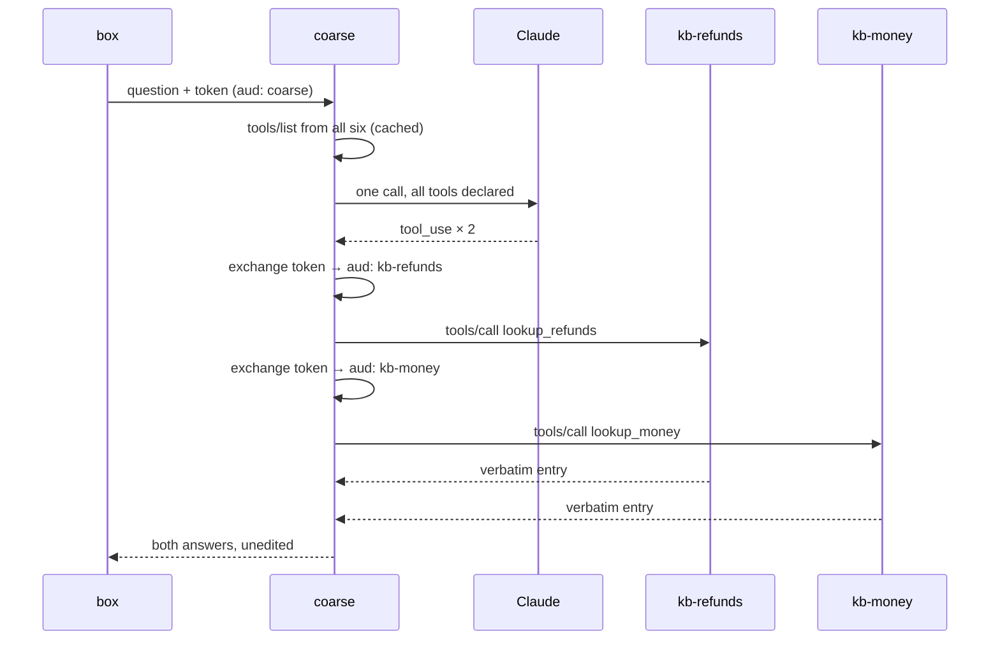

# Plan: The Ask mesh — six MCP servers, a coarse aggregator, and editable knowledge

- **Slug:** ask-mcp-mesh
- **Branch:** feature/ask-mcp-mesh
- **Status:** adjudicated

## Prompt

> create a plan from docs/plans/ask-mcp.md

Scope was settled across several messages. The first pass planned the pre-split
groundwork (§7.2–4); that plan was approved, then abandoned when the purpose
became clear. In the user's own words:

> But I prefer 6MCP servers if that isn't a bad design because I want to have an
> example for my job interview

> It doesn't have to be after all I just want a good example for how this would
> be done and perhaps a larger scale requirement, if a scale suggest that it
> doesn't need MCP that's no reason not to use it

> Do large

> Because I want to be able to demonstrate it

"Large" was chosen from three sizes offered in plain terms:

> **Large** — all of that, plus a web page for editing the answers and a
> scheduled job checking they haven't gone stale. Much bigger, and the editing
> page writes to production, which your own repo rules say should ship alone.

So: **§7 steps 5 through 8 of `docs/plans/ask-mcp.md`, complete.** The
groundwork item was not skipped so much as absorbed — §7 step 3's shared
validation module is what the write-time gate and the cron re-validation both
import, and neither can exist without it.

## Intent

Build the mesh `docs/plans/ask-mcp.md` describes, in full, as a working system
somebody can be shown.

**Demonstrability is a requirement, not a by-product.** The user wants to
exhibit this in a job interview, which means it has to run without their
Cloudflare dashboard open, and an interviewer should be able to point their own
MCP client at one of the servers and call it. A design that only works when
deployed to one account is not the artifact being asked for.

**The scale question is settled and closed.** §2 of the design document is
honest that at 72 entries the split is "a wash or slightly worse", and §10
records when the mesh is the wrong shape. The user has read both and decided:
*"if a scale suggest that it doesn't need MCP that's no reason not to use it."*
So no step in this plan re-litigates whether to build it. The architecture is
designed for the corpus that would justify it — several hundred entries across a
dozen domains — and the tradeoff at today's 72 is *stated* rather than resolved.
An over-built system whose author names the disproportion reads as judgment; the
same system defended as necessary reads as naivety, and the document is where
that difference lives.

What must survive intact from the shipped design: **an answer about terms is
never composed.** Every policy answer is returned byte-for-byte from a written
entry. The model may compose *numbers* a live tool returned, never *terms*. That
is the property that makes it safe to put in front of somebody who has signed
nothing, and it is the one thing the split must not cost.

## Acceptance criteria

### The knowledge, split and served

- [ ] **AC1:** When the six R2 objects are seeded from `worker/src/knowledge-base.md`
      and read back, they carry all 72 entries exactly once between them, each in
      the domain that answers its question, and every answer is byte-identical to
      the one committed today.

- [ ] **AC2:** When `lookup_<domain>` is called on a fine server with a question
      it can answer, it returns `{ id, answer, cite, audience }` where `answer`
      is byte-identical to the R2 object's text for that id. When a caller's
      token carries only `read:policy`, entries not marked `Audience: anyone` are
      absent from the result — not filtered late, but never loaded into the
      candidate set.

- [ ] **AC3:** When an R2 object is missing, unparseable, or fails validation at
      read time, that fine server answers the tool call with an explicit failure
      naming the domain, and the coarse server degrades to the contact address
      rather than to an error page or a composed answer.

### The mesh

- [ ] **AC4:** When a question arrives at the coarse server, it makes **exactly
      one** model call in which **all** tools from **all six** fine servers are
      declared, and makes **no** model call of its own to choose a domain. A test
      counts the calls and fails at two.

- [ ] **AC5:** When a question spans two domains — "what if a refund comes after
      you've paid me" — the coarse server forwards both tool calls the model
      makes and both answers reach the asker. This is the criterion the whole
      aggregate-don't-route decision exists for.

- [ ] **AC6:** When a fine server is unreachable or times out, the coarse server
      answers from the tools that did respond, and says which domain was
      unavailable. One dead server does not take the mesh down.

- [ ] **AC7:** Each of the six fine servers speaks MCP over Streamable HTTP at
      its own endpoint: `initialize`, `tools/list`, and `tools/call` all succeed
      against a standards-compliant client, so a third-party MCP client can
      connect to one directly.

### Auth

- [ ] **AC8:** Only the existing worker can mint. It holds the private key; the
      six fine servers and the coarse server hold the public key only, and a test
      asserts no private key material is reachable from any of their configs.

- [ ] **AC9:** When the coarse server forwards a tool call to `kb-money`, the
      token it sends is audienced to `kb-money` alone. When that exact token is
      replayed against `kb-refunds`, it is refused on `aud` — proving the
      exchange, and that a compromised fine server cannot reach its siblings.

- [ ] **AC10:** When a partner's `status` is not `active`, the minted token
      carries no `read:own-money`, and every live tool refuses it. Approval means
      something at the token layer rather than in each handler's memory.

- [ ] **AC11:** When an anonymous visitor asks, the live tools are **not declared
      to the model at all**, and a forged token naming one is still refused by
      the fine server. Two independent refusals, and a test drives both
      separately so that neither can be resting on the other.

- [ ] **AC12:** Each auth failure — absent, malformed, bad signature, expired,
      wrong `aud`, missing `scope`, `status` no longer active, Turnstile
      unsolved — returns what the design says it should, and the cases the
      design says are deliberately indistinguishable to the caller are
      indistinguishable in the response.

- [ ] **AC13:** The model never receives a token. A test asserts no token
      material appears in any prompt, tool description, or tool result the model
      sees — because a design where a token can reach the model's context is one
      where a prompt injection can exfiltrate it.

### Live data

- [ ] **AC14:** When an active partner asks why they have not been paid,
      `payout_status` returns their real blockers and figures, and the answer
      names the specific ones — the amount short of the floor, the details
      changed within the hold — rather than reciting the six conditions.
      `commission_ledger`, `refund_check`, and `code_status` likewise return real
      rows for an authorized caller.

- [ ] **AC15:** The model may compose numbers a live tool returned. It may never
      compose terms: when a question is about policy, the text shown is
      byte-identical to a `lookup_*` entry. A test drives a question that mixes
      both and asserts the policy half is verbatim.

### The editor, and the two gates

- [ ] **AC16:** When an operator saves a valid edit through the editor, the new
      markdown is written to R2 as a new version, the fine server serves it on
      the next request with no deploy, and the previous version is recoverable in
      one action.

- [ ] **AC17:** When an operator saves an edit that breaks a rule — a placeholder
      on a public entry, a duplicate id, a `§N` that no longer resolves, a number
      that disagrees with a deployed constant — **nothing is written**, and the
      response names the entry and the rule it broke.

- [ ] **AC18:** When a deployed constant moves so that a stored answer stops
      being true with no edit involved, the scheduled re-validation detects it
      and alerts, naming the object, the entry, the number it says, and the
      number the code now holds. This is the failure a write-time gate cannot
      see, and it is the class of defect this repository has actually shipped.

- [ ] **AC19:** The editor is reachable only behind the existing Cloudflare
      Access application and only by an address in `ADMIN_OPERATORS`. With either
      `ACCESS_TEAM_DOMAIN` or `ACCESS_AUD` unset, every write route answers 403.

### Not breaking what is live

- [ ] **AC20:** With `ASK_VIA_MESH` unset or false, `/api/partners/ask` and
      `/api/partner/ask` behave exactly as they do today and
      `tests/e2e/ask.spec.ts` passes untouched. The mesh ships inert; a deploy
      changes nothing until the flag is turned on.

- [ ] **AC21:** With the flag on, the box on the partner screen answers through
      the mesh, and an equivalent e2e test drives it end to end with the network
      mocked at the edge.

### Demonstrable

- [ ] **AC22:** When `npm run mesh:dev` runs on a machine with no Cloudflare
      credentials, all seven workers start locally against a local R2, seeded
      from the committed markdown, and a question asked at the local partner
      screen is answered through the mesh.

- [ ] **AC23:** `docs/plans/ask-mcp-architecture.md` exists, carries every
      diagram §8 requires — the router as a `sequenceDiagram` with both hops and
      the two-tool case, the request path anonymous and signed-in, the six
      authentication diagrams, the knowledge lifecycle with the cron loop drawn
      separately, the failure paths, and the domain map — and opens with a dated
      audit table whose every row names the file and symbol that proves it. When
      a diagram is missing or a cited symbol no longer exists, the suite fails
      naming which.

- [ ] **AC24:** A runbook shows how to connect a third-party MCP client to one
      fine server and call it, and how to reach every part of the system in a
      demo: the two-tool answer, a live figure, an edit taking effect without a
      deploy, a refused bad edit, and a replayed token being rejected.

## Non-goals

- **No change to the wording of any entry.** Not one word of
  `worker/src/knowledge-base.md` moves. The split is a move, not a
  reclassification, and AC1 is what says so. If a check finds an entry that has
  already rotted, that is a finding to report, not to fix here.
- **No new domains, no reclassified entries.** The six domains are §3's, derived
  from entry-id prefixes that already exist.
- **No model change.** `ASK_MODEL` stays `claude-opus-5` at `effort: low`.
- **`ask:eval` does not join `npm test`.** It costs money and is not
  deterministic; `scripts/ask-eval.ts` explains at length why a suite that is
  sometimes red for neither of the reasons a suite is red teaches people to
  ignore it.
- **The eval is not run by this work item.** It needs `ANTHROPIC_API_KEY`, which
  is not in this environment. The baseline machinery is built; taking the number
  is a named human step.
- **No Cloudflare resources are created and nothing is deployed.** Creating the
  R2 bucket, generating and installing the signing key, deploying seven workers,
  and turning on `ASK_VIA_MESH` are account actions the pipeline cannot take and
  must not attempt. They are written out as a runbook.
- **No production D1 writes, no refunds, no charges.** The live tools read.
- **Not a second knowledge base.** `worker/src/knowledge-base.md` remains the
  edited source and the seed for R2; this work item does not delete it or make
  R2 the only copy. That divorce is a follow-up, and doing it here would make a
  storage re-key ride along with everything else.

## Open questions

None blocking. Four things were verified against current documentation before
this was written, and two of them changed the design:

- **`McpAgent` is deprecated and feature-frozen.** Cloudflare's current guidance
  is *"Do not create a new `McpAgent` server. Use a stateless `createMcpHandler`
  server instead."* Stateless, Streamable HTTP, **no Durable Object**. §9 worried
  about DO backing and cost; it is moot, and six fine servers are six plain
  Workers.
- **Standard `Ed25519` is supported** in Workers' Web Crypto under the Secure
  Curves API, alongside legacy `NODE-ED25519`. But **raw import of private keys
  is explicitly unsupported**, so the mint imports PKCS8 or JWK. S2 settles which
  before anything is built on it.
- **A Worker acting as an MCP *client* is not documented.** The coarse server
  needs exactly that. The MCP TypeScript SDK was replatformed onto Web Standards
  in early 2026, which makes it plausible — and if it does not work in workerd,
  the fallback is to speak Streamable HTTP JSON-RPC directly over `fetch`, which
  is a few hundred lines and removes a dependency. **S2 decides this in a spike
  before S5 depends on it**, because discovering it during the build is what
  wrecks a schedule.
- **Two model calls became one.** §2 costed the mesh at two calls — pick a
  domain, then pick an entry. Aggregating rather than routing (§1) makes it one,
  which is why §2's cost table does not apply to what is being built here and why
  AC4 counts the calls.

## Approach

### One decision the design document already took, and everything follows from it

**The coarse server aggregates and declares; it does not route.** It collects
`tools/list` from all six fine servers, hands the model every tool in a single
request, and forwards whichever the model picks. It never makes a model call of
its own to decide which fine server is relevant.

That is the difference between one model call and three, and — more importantly
— it is what keeps cross-domain answers. A router that picks one domain gets
`refund-after-payment` wrong, because "what if a refund comes after you've paid
me" is a refunds question *and* a money question. AC5 is that case, and it is the
criterion this whole architecture is justified by.

### What gets built, and where

| Path | What |
|---|---|
| `worker/src/kb/rules.ts` | The pure parser and `validateKnowledgeBase(entries, source, facts)`. Imports nothing from `node:*`, `scripts/`, or `src/`, because the write gate and the cron worker both run it. One definition of "valid", not two that drift. |
| `worker/src/kb/domains.ts` | The six domains, their entry-id prefixes, and which hold live tools. Adding a seventh is an entry here plus an R2 object — the extensibility the scale argument rests on. |
| `worker/src/mint.ts` | EdDSA sign, the claim shape, and the exchange. The only place a private key is used. |
| `mcp/shared/` | `auth.ts` (verify: signature → `exp` → `aud` → `scope`, calling back to nobody), `kb-store.ts` (R2 read, parse, validate, cache), `server.ts` (`createMcpHandler` wiring). |
| `mcp/fine/<domain>/` | Six directories, each an `index.ts` and a `wrangler.toml`. Each declares `lookup_<domain>`; money, refunds and codes also declare their live tools. |
| `mcp/coarse/` | Aggregation, the single model call, the exchange, forwarding, and the daily ceiling — which has to live here because this is the only place that sees a whole question. |
| `worker/src/admin-kb.ts` | The editor's routes, behind the existing Access application. |
| `worker/src/kb-cron.ts` | The scheduled re-validation. |
| `src/admin/Knowledge.tsx` | The editor screen. |
| `scripts/kb-push.ts` | Seeds and re-seeds the six R2 objects from the committed markdown. |
| `scripts/mesh-dev.ts` | `npm run mesh:dev` — all seven locally, local R2, seeded. AC22. |
| `docs/plans/ask-mcp-architecture.md` | §8's document, plus the demo runbook. |

### Six Workers, not one Worker with six routes

One Worker serving six `createMcpHandler` instances at six paths would be six
MCP servers by the protocol, one deploy, and much less ceremony. It is rejected
because it throws away the property being demonstrated: six separate Workers
means six sets of secrets and six blast radii, and the token exchange has
something real to protect. `npm run mesh:deploy` absorbs the ceremony. The
rejected alternative goes in the architecture document — it is a better answer
for most teams and saying so is the point.

### Shipping inert

`ASK_VIA_MESH` defaults off. Everything here can land, be deployed, and change
nothing a visitor sees until the flag is turned on (AC20). That matters because
this repository's rule is that a change whose failure is silent and irreversible
ships as its own PR with no visible change alongside it — and the R2 split plus
an editor writing production knowledge is exactly that. The flag is what lets the
code land without the cutover riding along, and the cutover is then a
one-variable change with a one-variable rollback.

**Claims** — assertions this approach rests on, each of which could be false:

- [x] C1: **Verified (S2).** `createMcpHandler` from Cloudflare's Agents SDK serves stateless
      Streamable HTTP with no Durable Object binding, and `McpAgent` is
      deprecated for new servers.
- [x] C2: **Verified (S2), true.** A Worker can act as an MCP *client* over Streamable HTTP — undocumented,
      and the reason S2 is a spike. If false, the coarse server speaks JSON-RPC
      over `fetch` directly and nothing else in the plan changes.
- [x] C3: **Verified (S2).** Workers' Web Crypto signs and verifies Ed25519, and a private key can be
      imported from a Worker secret as PKCS8 or JWK. Raw private-key import is
      documented as unsupported.
- [x] C4: **Verified (S2), with a correction — see Build notes.** `@cloudflare/vitest-pool-workers` can run more than one Worker in a test
      and bind R2, so the mesh is drivable in `npm run test:worker` without
      deploying anything.
- [x] C5: **Verified.** All 72 entries partition cleanly across §3's six prefix
      groups — none left over, none claimed twice. The split is a move, not a
      reclassification. **But §3's own counts are wrong**: it totals 67 and the
      real distribution is joining 23, money 13, account 12, refunds 11, codes 7,
      promotion 6. Use the computed partition, not the table.
- [x] C6: **Verified (S14), and further off than the plan says — see Build notes.** As the design document states it, partly false. The queries exist,
      but three of the four are module-private and two are in a different file
      than §6's table claims: `summaryFor` (`worker/src/partner-api.ts:1142`),
      `ledgerFor` (`partner-api.ts:1182`) and `describePartner`
      (`partner-api.ts:1008`) are all unexported — §6 names `commissions.ts` for
      the middle one, which exports `balanceFor` and `whyNoCommission` instead.
      Only `payoutBlockers` (`worker/src/payouts.ts:105`) and `checkRefund`
      (`worker/src/refund-admin.ts:55`) are already exported. So S14 exports three
      functions before it can call them — no new query, but not "already written"
      in the sense §6 implies.
- [x] C7: **Verified (S3), off by one.** `tests/unit/knowledge-base.test.ts` holds 28 checks, of which 20 need only
      entries, source text and quoted numbers — those are what `rules.ts` becomes —
      and 8 read repository files a Worker will never have, so those stay in the suite.
- [x] C8: **Verified.** `worker/src/partners.ts:228` selects sessions where
      `p.status IN ('pending', 'active', 'suspended')`, so anybody who can receive
      email holds a session minutes after applying. That is the hole AC10 closes
      at the token layer.
- [x] C9: **Verified (S17).** The Access application already covers `/admin` and `/api/admin`, so the
      editor needs no new identity system — only new routes under those paths.
- [x] C10: **Verified (S19).** `MailSender` in `worker/src/mail.ts` is injectable, so the cron
      re-validation can alert through it and be driven in tests with no network.

## Steps

**Phase 0 — settle what the build rests on**

- [x] S1: Partition the 72 entries across the six domains from §3's prefixes;
      confirm none is left over or claimed twice (C5). Write it as data in
      `worker/src/kb/domains.ts`.
- [x] S2: Spike, in this order, and record each answer: a Worker as MCP client
      (C2) — if it fails, write the `fetch` JSON-RPC fallback now; Ed25519 sign
      and verify in workerd with a PKCS8 or JWK secret (C3); two workers plus an
      R2 binding under `vitest-pool-workers` (C4). **Nothing after this depends
      on a guess.**

**Phase 1 — the knowledge, shared and stored**

- [x] S3: Lift the parser and the 20 portable checks into `worker/src/kb/rules.ts`;
      leave the 8 repository-file checks in the suite; keep every test name and
      failure message. Mutation-test each: reapply the mutation it was written to
      catch, confirm it still fails naming the same rule, restore.
- [x] S4: `scripts/kb-push.ts` splits the markdown into six objects and writes
      them; a test reads them back and asserts byte-identity and a clean
      partition (AC1).

**Phase 2 — the fine servers**

- [x] S5: `mcp/shared/` — the MCP handler wiring, the R2-backed store with
      read-time validation, and `auth.ts` verifying signature, `exp`, `aud`,
      `scope`, in that order, calling back to nobody.
- [x] S6: The six fine servers, each with `lookup_<domain>` returning verbatim
      text and its own `wrangler.toml` (AC2, AC7). Drive `initialize`,
      `tools/list` and `tools/call` against each.
- [x] S7: Failure paths at a fine server: missing object, unparseable object,
      object failing validation (AC3).

**Phase 3 — auth**

- [x] S8: The mint in the existing worker — claim shape, Ed25519 signing,
      15-minute lifetime, Turnstile for anonymous, `hl_partner` for signed-in,
      and `read:own-money` derived from `status === 'active'` (AC8, AC10).
- [x] S9: The exchange: coarse presents its token, receives one audienced to a
      single fine server. Test the replay refusal explicitly (AC9).
- [x] S10: Every failure path, and the deliberate indistinguishabilities (AC12).
      Mutation-test each guard by removing it and confirming the test goes red.

**Phase 4 — the coarse server**

- [x] S11: Aggregate `tools/list` from six, declare all in one model call, forward
      the chosen tools, return verbatim (AC4, AC5). Count the model calls in a
      test and fail at two.
- [x] S12: Degradation: a dead fine server (AC6), the daily ceiling enforced here
      because this is the only place that sees a whole question, and the contact
      address as the floor every failure lands on.
- [x] S13: Assert no token material reaches the model — prompts, tool
      descriptions, tool results (AC13).

**Phase 5 — live data**

- [x] S14: `payout_status` on kb-money first, since it answers the question the
      portal exists to answer; then `commission_ledger`, `refund_check`,
      `code_status`, each gated on `read:own-money` (AC14).
- [x] S15: The compose rule: numbers may be composed, terms never. State it in the
      coarse system prompt, in every tool description, and in a test that drives a
      mixed question and asserts the policy half is byte-identical (AC15).
- [x] S16: Anonymous callers are never *declared* the live tools, and a forged
      token is refused anyway. Two tests, neither resting on the other (AC11).

**Phase 6 — the editor and both gates**

- [x] S17: `worker/src/admin-kb.ts` and `src/admin/Knowledge.tsx` behind the
      existing Access application (AC19). List, edit, save.
- [x] S18: The write-time gate: `rules.ts` runs before the object is written, and
      a refusal names the entry and the rule (AC17). Versioned writes, never in
      place, with the previous version recoverable in one action (AC16).
- [x] S19: The cron re-validation, alerting through the injectable `MailSender`
      when a deployed constant has moved under a stored answer (AC18). This is the
      one that catches the failure with no edit involved.

**Phase 7 — cutover, demo, document**

- [x] S20: `ASK_VIA_MESH`, defaulting off. The existing routes unchanged when it is
      unset (AC20); the mesh path driven by an e2e test when it is set (AC21).
- [x] S21: `npm run mesh:dev` — seven workers, local R2, seeded, no credentials
      (AC22). And `npm run mesh:deploy` for the seven-deploy ceremony.
- [x] S22: `scripts/ask-eval.ts` gains a committed baseline, `--record`, and a
      delta print that exits non-zero on a drop. Do not run it.
- [x] S23: `docs/plans/ask-mcp-architecture.md` — the dated audit table from S1
      and S2 first, then §8's diagrams and the authentication chapter, then the
      demo runbook (AC23, AC24). Guard it: required diagrams present, cited
      symbols still exist, relative links resolve. Mutation-test all three.
- [x] S24: `npm test` green, whole suite, clean tree. PR naming the account steps
      nobody in the pipeline can take: create the R2 bucket, generate and install
      the signing key, deploy seven workers, run the eval once, then flip the flag.

## Test strategy

Behaviour through the outermost surface that shows it, which here is three
surfaces rather than one:

- **workerd (`npm run test:worker`)** is the outermost surface for everything
  protocol- and auth-shaped: `initialize` / `tools/list` / `tools/call` against
  each fine server, the exchange and its replay refusal, every auth failure path,
  the model-call count, the write gate's refusals, and the cron's alert. These
  are not unit tests of helpers — they drive assembled Workers over HTTP with R2
  bound, which is why S2 verifies the multi-worker test harness before anything
  depends on it.
- **Playwright (`npm run test:e2e`)** for the two things a person operates: the
  box answering through the mesh with the flag on (AC21), and the editor saving
  a good edit and being refused a bad one (AC16, AC17). Network mocked at the
  edge, per this repo's convention.
- **`tests/unit/`** only for what has no outer surface: the entry partition
  (AC1), the eval baseline comparison, and the architecture document's guards.

**AC20 is the criterion this change is weighed on.** Everything else can be
rebuilt; a silent change to what a prospective partner is told cannot be taken
back. `tests/e2e/ask.spec.ts` passing *untouched* with the flag off is what says
the mesh landed inert.

Every new guard is mutation-tested — break the thing it guards, confirm the test
fails, restore. S3, S10, S16 and S23 name those passes explicitly, and they are
not deferrable: a guard that has never failed has proven nothing, and this change
adds more guards than anything before it in this repository.

## Build notes

Written during the build. Every deviation from the plan is here, in the order it
happened.

### S2 — what the spike settled

All four claims verified in workerd before anything depended on them. The
answers are also in the audit table at the top of
[docs/plans/ask-mcp-architecture.md](../../plans/ask-mcp-architecture.md).

- **C1 true.** `createMcpHandler` from `agents/mcp/server` serves `initialize`,
  `tools/list` and `tools/call` statelessly, with no Durable Object binding.
  Responses come back SSE-framed by default, which the SDK client handles.
- **C2 true, and the fallback was not needed.** A Worker *can* act as an MCP
  client: `StreamableHTTPClientTransport` from `@modelcontextprotocol/client`
  accepts an injected `fetch`, so the transport is a service binding. The
  Agents SDK's own `MCPClientManager` was **not** used — it is a lifecycle
  capability installed on a Durable Object, and the mesh is deliberately
  stateless. `@modelcontextprotocol/client/validators/cf-worker` supplies the
  Workers-compatible JSON Schema validator.
- **C3 true.** Ed25519 sign and verify work in workerd. PKCS8 private import
  works (48 bytes); JWK public import works. **Raw private import is refused**,
  and the error names the wrong problem — *"Attempt to import public Ed25519 key
  with invalid usage sign"*.
- **C4 true with a correction, recorded below.**

### PLAN DEFECT — C4's multi-worker harness is not what the plan assumed

**What was wrong.** S2 and the test strategy assume
`@cloudflare/vitest-pool-workers` can "run more than one Worker in a test".
It can, through `poolOptions.workers.miniflare.workers`, but those auxiliary
workers are `SourcelessWorkerOptions` — they need a **pre-built script** and do
not go through Vite's transform. Registering the six fine servers that way would
put an esbuild step between `mcp/fine/*/index.ts` and every assertion about it,
which is the shape of thing that eventually tests a stale bundle.

**What was done instead.** Each Worker's own default export is imported and
driven over `Request`/`Response` in the same isolate, with a real local R2 bound
from `worker/wrangler.toml`. That is still the assembled Worker over its own
HTTP surface — `worker/tests/mesh-fine.test.ts` connects the **MCP SDK's own
client** over `StreamableHTTPClientTransport` to it, which is what makes AC7 a
claim about the protocol rather than about a hand-rolled poke. The coarse
server's six service bindings are the same dispatch (`fineBinding` in
`worker/tests/mesh.ts`), so `worker/tests/mesh-coarse.test.ts` drives the whole
mesh with nothing stubbed but the model.

**What should happen.** Nothing, unless somebody wants the extra fidelity of
separate isolates; the cost is a build step and the gain is small. Worth knowing
before anybody tries `miniflare.workers` and finds out the hard way.

### PLAN DEFECT — an existing test forbids the cron the plan requires

**What was wrong.** S19 and AC18 require a scheduled re-validation.
`tests/unit/partner-schema.test.ts` — *"nothing extends a partner code except
somebody deciding to"* — asserts that `worker/wrangler.toml` has no cron trigger
and that no file under `worker/src/` exports a `scheduled` handler. The plan did
not know about it. Adding the trigger there turned that test red, and weakening
it is not something a build step may do.

**What was done instead.** The trigger lives in its own Worker,
`mcp/cron/wrangler.toml` and `mcp/cron/index.ts`, importing the same
`runKnowledgeCheck` from `worker/src/kb-cron.ts` that the plan asked for. The
partner worker keeps having no cron and no scheduled handler, so the existing
assertion passes **untouched** and the invariant it protects — that nothing
renews a partner code on a schedule — is stronger rather than weaker.
`tests/unit/mesh-config.test.ts` now holds both halves: `kb-cron` has the
trigger, and the partner worker does not.

**What should happen.** Nothing to undo. But the existing guard is a proxy: it
bans *all* crons to prevent one specific kind, and the next scheduled job will
hit the same wall. Whoever adds one should decide deliberately between another
worker and narrowing that assertion to the invariant its own docstring names.

### PLAN DEFECT — S12's premise about the daily ceiling is false in the built design

**What was wrong.** S12 says the daily ceiling must be "enforced here because
this is the only place that sees a whole question", following §9 of the design
document. That was true of the **two model calls per question** shape §2 costed.
What was built makes **one** call, and the box still posts to
`/api/partners/ask` and `/api/partner/ask` — so the existing worker sees every
whole question, counts it, and mints a token only after `pastCeiling` has
passed. `PUBLIC_DAILY_QUESTIONS` and `PARTNER_DAILY_QUESTIONS` therefore bound
exactly what they always bounded: one model call per question.

**What was done instead.** The ceilings stay where the questions are counted.
The coarse server enforces `MAX_TOOL_CALLS` (four), which bounds the *fan-out*
of a single question — the thing that is genuinely new — and is unreachable
without a token only the ceiling-checked worker can mint. Both are written into
the header comment of `mcp/coarse/index.ts` so the difference is not something
somebody has to notice.

**What should happen.** If the coarse server is ever given a public route of its
own, or a second model call is added, this has to be re-taken and it will need a
store.

### AC4 and AC15 cannot both be taken at their word, and AC4 wins

AC4 requires **exactly one** model call. AC15 says the model *may* compose
numbers a live tool returned. With one call there is no turn on which the model
sees a tool result, so the permission is stated and never exercised: the compose
rule is in the coarse system prompt and in every tool description, and the live
figures reach the asker in the words `payoutBlockers` and the queries themselves
produced.

This is the safer reading of the two and it is the one the Intent asks for —
*"an answer about terms is never composed"* — but it is a real narrowing of
AC15's first sentence and it is a decision rather than an oversight. The
alternative is a second model call carrying the tool results, which fails AC4's
counted test and puts a model between a partner and a sentence about their money.

### C6 was further off than the plan says

The plan expected S14 to export `summaryFor`, `ledgerFor` and `describePartner`.
What actually happened:

- `ledgerFor` **was** exported, and its signature changed from `(db, partnerId,
  url: URL)` to `(db, partnerId, before: number)`. A fine server has no query
  string, and synthesising a `URL` to satisfy a signature is how a function ends
  up shaped by its first caller for ever. The one existing call site passes the
  parsed number.
- `summaryFor` was **not** needed. `balanceFor` (already exported from
  `commissions.ts`) and `payoutCandidates` (already exported from `payouts.ts`)
  answer `payout_status` between them, with `payoutBlockers` for the reasons.
- `describePartner` was **not** exported, deliberately. It answers the portal's
  own screen and carries a partner's name, address, terms and payout details,
  and `code_status` hands its result to a model. A tool returning somebody's
  email address into a prompt would be a worse leak than anything the audience
  split protects against. Instead `codeStatusFor` was added to
  `worker/src/learners.ts` beside `codesFor` — **one new query**, which C6 said
  would not be needed. It returns four fields and nothing else.

### C7 is off by one

The plan says 20 portable checks and 8 that read repository files.
`tests/unit/knowledge-base.test.ts` held 28, and the honest split is **19
portable and 9 file-reading**. The nine that stayed read `knowledge-base.json`,
`agreement.md`, `privacy.md`, `Privacy.tsx`, `src/ask.ts`, `src/legal.ts` and
the worker's own source text. Every one of the nineteen keeps its test name and
its failure message, now carried as `Violation.detail`.

`tests/unit/kb-rules.test.ts` is new and was not in the plan: it breaks each of
the nineteen rules on purpose and asserts it fires and names the right entry.
S3 asked for that as a manual pass; as a table in the suite it is permanent, and
the rules now run in production where a guard that silently stopped firing would
take the write gate and the cron with it.

### Two constants were added so a check could run in a Worker

Two rules needed numbers that only existed in files a Worker cannot read.

- `AGREEMENT_SECTIONS` in `worker/src/agreement.ts` — the sections the agreement
  has, so *"names only sections the agreement actually has"* can run in the
  write gate and the cron. Held to the document's own headings by a new
  assertion in `tests/unit/knowledge-base.test.ts`.
- `SEEDED_CLEARING_DAYS` in `worker/src/kb/facts.ts` — the clearing window is a
  property of a `programs` row, not a constant, so `worker/schema.sql`'s seed is
  the only place the shipped number is written. Held to that seed by the same
  test, which also asserts `deployedFacts()` equals the facts the suite
  assembles by hand, so the live gate and the suite cannot check different
  numbers.

### Smaller deviations, recorded because they are deviations

- **`worker/src/kb/split.ts` exists** and the plan's table does not list it. The
  split is needed by `scripts/kb-push.ts`, by `npm run mesh:dev` and by the
  workerd suite, and only the first is a Node program — `scripts/kb-push.ts`
  imports `node:fs` and `node:child_process` at module scope and cannot be
  loaded in workerd.
- **`worker/src/mesh-ask.ts` exists** and the plan's table does not list it. It
  is the seam: it mints the token, calls the coarse server, and returns
  `undefined` when the flag is off — which is what makes AC20 a property of the
  dependency graph rather than of a condition somebody has to remember to check.
- **`NO_MATCH`, `PARTNER_CONTACT_EMAIL` and `PLACEHOLDERS` moved** from
  `worker/src/ask.ts` into `worker/src/kb/rules.ts`, and are re-exported from
  `ask.ts` so no existing importer changed. A fine server validating an R2
  object needs them and must not drag the Anthropic client into its bundle.
- **The coarse server reaches the fine servers over service bindings**, not
  URLs. The plan does not say which. Worker-to-worker means no DNS, no TLS
  handshake, no egress, and every edge in the mesh is a reviewable line in
  `mcp/coarse/wrangler.toml`.
- **`[[services]] COARSE` is commented out in `worker/wrangler.toml`.** A
  service binding names a worker that must already exist, so adding it before
  `ask-coarse` is deployed would make `npm run deploy` fail — and the mesh would
  not have landed inert. Uncommenting it is step 8 of the runbook.
- **`ASK_VIA_MESH` is not bound in the worker test environment**, so every
  existing ask test answers the way it always did and the mesh tests construct
  the dependency themselves.
- **A throwaway Ed25519 pair is bound in `worker/vitest.config.ts`**, following
  the precedent of `STRIPE_WEBHOOK_SECRET: 'whsec_test_isolation'`. A suite that
  could not sign could only ever prove the refusals. It has never existed
  anywhere else and the deployed key is a Worker secret installed by hand.
- **`tests/e2e/ask-mesh.spec.ts` is a new file rather than an edit to
  `tests/e2e/ask.spec.ts`.** AC20 turns on that file passing *untouched*, and a
  spec edited in the same change cannot say that. `tests/e2e/kb-editor.spec.ts`
  joins the `routing` project for the same reason `admin.spec.ts` does, which
  needed one line of `playwright.config.ts`.
- **Four dependencies were added**: `agents`, `@modelcontextprotocol/server`,
  `@modelcontextprotocol/client` and `zod`, in `dependencies` beside
  `@anthropic-ai/sdk` because they are what the deployed mesh workers run on.

### Mutation passes

S3, S10, S16 and S23 name these as not deferrable. Every one below was applied,
observed red, and restored.

| Mutation | What went red |
|---|---|
| Nineteen data mutations, one per rule | `tests/unit/kb-rules.test.ts`, as a permanent table |
| Drop the `aud` check in `verifyToken` | 5 of 23 in `mesh-auth` |
| Drop the `exp` check | 2 of 23 in `mesh-auth` |
| Name the reason in the 401 body | the indistinguishability case |
| Stop filtering entries by audience | `mesh-fine`, the policy-only candidate set |
| Declare live tools regardless of scope | 2 of 20 in `mesh-coarse` (AC11, AC10) |
| Serve an object that failed validation | `mesh-fine`, AC3 |
| Add a second model call to pick a domain | 5 of 20 in `mesh-coarse` (AC4) |
| Write without running the gate | 6 of 19 in `mesh-editor` (AC17) |
| Overwrite in place, archiving nothing | `mesh-editor`, AC16 |
| Let the cron pass quietly on a moved constant | 2 of 19 in `mesh-editor` (AC18) |
| Stop re-checking the audience on a mesh answer | `mesh-ask`, the second independent no |
| Remove a required diagram | `mesh-architecture`, naming which |
| Rename a cited symbol | `mesh-architecture`, naming the claim |
| Break a relative link | `mesh-architecture`, naming the link |

### Left out on purpose

- **The eval was not run and the baseline is empty.** `scripts/ask-eval-baseline.json`
  is committed with `recordedAt: null`, and says in its own note why. It needs
  `ANTHROPIC_API_KEY`, which this environment has none of. Recording it against
  the **old** router before `ASK_VIA_MESH` is turned on is step 6 of the runbook,
  and it is the only before-number that will ever exist.
- **No Cloudflare resource was created and nothing was deployed.** The R2 bucket
  does not exist, the key pair was never generated for production,
  `MESH_PUBLIC_KEY` is an empty string in all seven mesh configs, and no worker
  was deployed. Every config was checked with `wrangler deploy --dry-run`.
- **`npm run mesh:dev` was not run end to end.** It starts eight long-lived
  processes; the pieces it is built from were exercised — the split, the local
  R2 seed, `mesh:key`, and every worker's config through `--dry-run` — but the
  full run is a demo step, not a pipeline step.
- **Not one word of `worker/src/knowledge-base.md` moved.** `tests/unit/kb-partition.test.ts`
  is what says so, byte for byte, in both directions.

---

# Appendix: everything needed to answer questions about this without the repository

Written to be pasted into a conversation on its own. Everything above is the
plan as it was approved and then annotated during the build; this section is the
system as it actually stands, stated flatly, including the parts that contradict
the plan. Where the two disagree, this section is right — it was written last.

**Status as of 2026-09-09:** merged to `main` in PR #208 and deployed. The mesh
is **inert in production**: `ASK_VIA_MESH` is an empty string, the `COARSE`
service binding and the `[[r2_buckets]] KB` block in `worker/wrangler.toml` are
both commented out, no Cloudflare resource for the mesh has been created, and no
mesh Worker has been deployed. The live ask box still answers through the old
single-worker router. `npm run mesh:dev` has now been run end to end, with a
real `ANTHROPIC_API_KEY`, and answers a question through the mesh — which the
build notes above say was not done, because at the time it had not been.

## A. What the thing is, in five sentences

A partner types a question into a box on `/partners/`. One Cloudflare Worker
(`learners-permit-api`) takes it, enforces the ceilings and the anti-robot
challenge, mints a short-lived signed token, and hands question and token to an
aggregator Worker (`ask-coarse`). The aggregator declares every domain's tools
to one model call, and the model replies with which tools to call — never with
prose. The aggregator calls those tools on the domain Workers, which return
**pre-written answers verbatim** out of an object store. The entry worker fills
in that partner's own figures and returns the text; nothing composes a sentence.

## B. Why "mesh" is a slightly wrong word

The topology is a **star**, not a mesh. `ask-coarse` holds all seven service
bindings. Each of the six domain Workers holds **none** — it cannot call a
sibling, cannot call the API worker, and has no outbound reach. That isolation
is deliberate: a domain server able to call another could assemble an answer
across the audience boundary its own check exists to hold.

The word is doing *service-mesh* work — per-hop identity and policy — rather
than describing a graph.

## C. The nine Workers

| Worker | Directory | Routes | Holds service bindings to |
|---|---|---|---|
| `learners-permit-api` | `worker/` | the public API | — (it is the mint) |
| `ask-coarse` | `mcp/coarse/` | none | all six below, plus `MINT` → `learners-permit-api` |
| `kb-joining` | `mcp/fine/joining/` | none | — |
| `kb-money` | `mcp/fine/money/` | none | — |
| `kb-refunds` | `mcp/fine/refunds/` | none | — |
| `kb-codes` | `mcp/fine/codes/` | none | — |
| `kb-promotion` | `mcp/fine/promotion/` | none | — |
| `kb-account` | `mcp/fine/account/` | none | — |
| `kb-cron` | `mcp/cron/` | none, cron `17 6 * * *` | — |

**Only `learners-permit-api` is reachable from the internet.** Every other
Worker has no route and no `workers.dev` address; they are reached solely
through service bindings, which are in-datacentre calls that never become
public HTTP requests. `npm run mesh:deploy` deploys all nine in one command.

Each domain Worker binds R2 (`learners-permit-kb`) and the same D1
(`learners-permit`) the API worker uses.

## D. The six domains

Domain membership is decided by the **prefix of an entry id**, so an entry moves
domain by being renamed and by nothing else. Defined in `worker/src/kb/domains.ts`.

| Domain | Entry-id prefixes | Live tools (D1-backed) |
|---|---|---|
| `joining` | `join-`, `compare-`, `terms-` | — |
| `money` | `paid-`, `earning-` | `payout_status`, `commission_ledger` |
| `refunds` | `refund-` | `refund_check` |
| `codes` | `code-`, `attribution-` | `code_status` |
| `promotion` | `promote-` | — |
| `account` | `account-`, `ending-`, `learners-`, `contact` | — |

Each domain's markdown is one R2 object at `kb/<domain>.md`. Each domain Worker
declares an MCP tool `lookup_<domain>` for its written answers, plus its live
tools above.

## E. Auth, which is the part with real content

- **Ed25519.** The private half exists only in the mint (`learners-permit-api`);
  the seven others hold the public half as a JWK in `MESH_PUBLIC_KEY`.
- **Token lifetime 900 seconds** (`TOKEN_TTL_SECONDS`), issuer pinned to
  `learners-permit-api` (`TOKEN_ISSUER`).
- **Exactly one audience per token** (`aud`) — either `ask-coarse` or one named
  domain Worker. The box's token is `aud: ask-coarse` and can be presented
  nowhere else. The aggregator **exchanges** it, once per domain, for six
  single-audience tokens. That exchange is §6 of the architecture document and
  is the centrepiece of the design.
- **Claims:** `iss`, `aud`, `iat`, `exp`, `status`, `scope`, and `sub` (the
  partner id) only when there is one. Anonymous askers carry no `sub`.
- **Scopes:** `read:policy` | `read:partner` | `read:own-money`, derived from
  the principal's status (`anonymous`, `unverified`, `pending`, `active`,
  `suspended`, `closed`) by `scopesFor` in `worker/src/mint.ts`. Concretely:
  anonymous gets `read:policy` alone; **anybody holding a session gets
  `read:partner`**, because that is what the old single-worker path meant and
  the mesh must not quietly narrow it; and **only `active` adds
  `read:own-money`**. `scopesForAudience` then narrows that set again to what
  the one domain being called is allowed to see.
- **A domain Worker never calls back to ask who someone is.** It verifies the
  signature and reads the claims. The cost is stated plainly in the source: a
  revoked partner holds valid authority until the token expires — **up to
  fifteen minutes of stale authority**, which is the deliberate trade for
  having no callback and no shared session store.

## F. The model's role, exactly

- **One model call per question** (`ASK_MODEL = 'claude-opus-5'`), capped at
  `MAX_TOOL_CALLS = 4`.
- The model receives the tool list and returns `tool_use` entries. In the
  legacy non-mesh path it returns a single field — an **id**, constrained by a
  JSON-schema enum of exactly the entries that audience may see.
- **It never writes an answer.** The router prompt says so: *"You never write an
  answer, and nothing you return is shown to anybody: the id you choose selects
  text that is already written."*
- Consequence: the system **cannot hallucinate an answer**, only mis-route to
  the wrong pre-written one. It is pushed toward `no-match`, which hands the
  asker a human, on anything about a named buyer, someone's own tax or legal
  position, whether a particular advert is compliant, or anything promising a
  date, amount or approval.
- **AC4 was ratified over AC15** (2026-09-09): with one model call there is no
  turn on which the model sees a tool result, so it can never compose a figure.
  Numbers reach a partner exactly as the tools emitted them.

## G. Timeouts, caches and ceilings

| Constant | Value | What it governs |
|---|---|---|
| `TOKEN_TTL_SECONDS` | 900 | token lifetime; also the revocation window |
| `KB_CACHE_SECONDS` | 30 | a domain Worker's cache of a good R2 read |
| `FINE_TIMEOUT_MS` | 5000 | aggregator → one domain Worker |
| `COARSE_TIMEOUT_MS` | 15000 | entry worker → aggregator |
| `MAX_TOOL_CALLS` | 4 | tool calls the model may request |
| `MCP_ROUTE` | `/mcp` | the path each domain Worker answers on |
| `PUBLIC_ENTRY_FLOOR` | 50 | minimum entries a stranger may reach |

`MAX_TURNS = 10` per conversation and `PUBLIC_DAILY_QUESTIONS = 300` a day for
anonymous askers.

The daily question ceiling and the Turnstile challenge stay on the **entry
worker**, not the aggregator — the plan assumed they would have to move, and
with one model call instead of two they did not. The turn is claimed in D1
*before* the model is asked, under a unique index on `(conversation, turn)`, so
a conversation can never cost more than `MAX_TURNS` model calls however it is
driven.

## H. The editor

An operator edits entries at `/admin/`. A write passes a gate, is stored as a
new R2 version, and is served with no deploy. Two things to know:

1. **Not "on the next request."** A domain Worker caches a good read for
   `KB_CACHE_SECONDS = 30`, and a save does not invalidate it, so a warm isolate
   can serve the old text for up to half a minute. AC16 is met *within 30
   seconds*. A test fails if that window grows.
2. **A new or renamed entry never reaches an asker.** The entry worker re-checks
   each returned id against `worker/src/knowledge-base.json`, which is compiled
   at build time — the second, independent audience check, in the worker that
   knows who is asking from a session rather than from a claim. A new entry
   saves, reaches R2, is served by the domain Worker, and is dropped at the last
   hop; the asker gets the contact address. The drop is logged with the id and
   audience. **Decided 2026-09-09: leave it, and document "a new entry needs a
   deploy" as the rule.** Editing an existing entry's *text* works live;
   adding or renaming does not.

## I. Known gaps, all decided rather than discovered

| # | Gap | Decision (2026-09-09) |
|---|---|---|
| 1 | New/renamed entry never reaches an asker | Leave; documented rule |
| 2 | Live tool figures render as `payableCents: 2000`, and a ledger array flattens into up to 100 undelimited lines | **Fix before `ASK_VIA_MESH` goes on**, as its own PR: each live tool returns display-ready lines the way `payoutBlockers` already does |
| 3 | A test bans *all* cron triggers on the partner worker to prevent one specific thing | Leave; the workaround (separate Worker) stands |
| 4 | Test harness cannot register auxiliary Workers without a build step | Informational; each Worker's default export is driven in-isolate |
| 5 | The plan's daily-ceiling premise was false | Correct as built; **re-take if the aggregator ever gets a public route or a second model call** |
| 6 | AC4 vs AC15 conflict | Ratify AC4; AC15 narrowed — the model never composes a figure |
| 7 | AC22's written answer unverified; first question of a cold `mesh:dev` run degrades | Leave; document "ask twice on a cold start". *Since resolved in practice: a run with a real key answered correctly, and the cold-start degradation is visible as `"unavailable":["account","joining"]` in the response, recovering to `[]` on the next question* |
| 8 | Eval baseline empty; rollout untaken | Merge inert, then record the baseline against the **old** router — the only before-number that will ever exist |

## J. Deploying it — nine steps nothing in the repository can take

1. Create the R2 bucket `learners-permit-kb`.
2. Generate the Ed25519 pair (`npm run mesh:key`).
3. Install the private half as a secret on `learners-permit-api`, the public
   half as `MESH_PUBLIC_KEY` on the other seven.
4. Seed the six R2 objects from `worker/src/knowledge-base.md`.
5. Deploy the eight mesh Workers (`npm run mesh:deploy`).
6. **Record the eval baseline against the old router** (`npm run ask:eval`) —
   this is the step with a deadline; once the flag flips the before-number is
   gone.
7. Fix gap 2 above.
8. **Uncomment two blocks in `worker/wrangler.toml`** — the `COARSE` service
   binding and `[[r2_buckets]] KB`. `tests/unit/mesh-config.test.ts` goes red
   when either is uncommented, so this is a deliberate deletion of an assertion,
   not a config that quietly broke.
9. Set `ASK_VIA_MESH`.

**The Workers API refuses a script bound to a resource that does not exist, and
`wrangler deploy --dry-run` will not warn you, because a dry run never contacts
the API.** Until step 8 the editor at `/admin` answers 503 and logs
`admin-kb: no KB bucket is bound`, which is the intended inert state.

## K. Running it locally

`npm run mesh:dev` starts all eight Workers plus the app with **no Cloudflare
credentials**: it generates a throwaway key pair, splits
`worker/src/knowledge-base.md` into six local R2 objects, applies the D1 schema,
and wires the service bindings through wrangler's dev registry. App on `:5173`,
API on `:8787`, mesh Workers on `:8800`–`:8806`. Ctrl-C stops all nine.

- Set `ANTHROPIC_API_KEY` for a real written answer; without it the aggregator
  names no tools and degrades.
- `.wrangler/mesh-state` is wiped and rebuilt each run. It was not, until
  2026-09-09, which meant the second run on any machine died on
  `duplicate column name: law` — SQLite cannot make `ADD COLUMN` conditional.
- Portal addresses need the dev-server middleware added the same day; before
  it, `/partners/agreement` rendered the learner's welcome page in dev while
  production was correct.
- A mesh answer is identifiable by the `unavailable` array in the response,
  which only the mesh path produces.

## L. Test inventory

| File | Layer | Covers |
|---|---|---|
| `worker/tests/mesh-auth.test.ts` | workerd | token minting, exchange, verification, expiry |
| `worker/tests/mesh-coarse.test.ts` | workerd | the aggregator: tool declaration, fan-out, degradation |
| `worker/tests/mesh-fine.test.ts` | workerd | a domain Worker's own MCP surface |
| `worker/tests/mesh-ask.test.ts` | workerd | how a tool result becomes lines a partner reads |
| `worker/tests/mesh-editor.test.ts` | workerd | the write gate and R2 versioning |
| `tests/unit/mesh-config.test.ts` | unit | the two blocks stay commented out |
| `tests/unit/mesh-architecture.test.ts` | unit | structural invariants of the mesh |
| `tests/unit/kb-partition.test.ts` | unit | the split is lossless, byte for byte, both ways |
| `tests/unit/kb-rules.test.ts` | unit | every corpus rule, each with a mutation |

Suite on the merge commit: **1117 unit, 621 workerd, 522 e2e, exit 0.**

## M. Vocabulary

- **ask box** — the input widget on `/partners/`. Not a bot; nothing in the
  system composes prose.
- **coarse server / aggregator** — `ask-coarse`. Makes the single model call
  and fans out.
- **fine server / domain Worker** — one of the six `kb-*` Workers.
- **written answer** — text served verbatim out of R2.
- **live tool** — a D1-backed tool returning a partner's own figures.
- **the mint** — `learners-permit-api`, the only holder of the private key.
- **exchange** — swapping the `aud: ask-coarse` token for six single-audience
  tokens, one per domain.
- **inert** — deployed, but with bindings commented out and the flag unset, so
  none of it is in the request path.

## N. Documents

- `docs/plans/ask-mcp-architecture.md` — how it works, 12 mermaid diagrams,
  audited against the built code on 2026-09-08. **Start here.**
- `docs/plans/ask-mcp.md` — the argument for the direction, and what it costs.
- `docs/work/ask-mcp-mesh/plan.md` — this file: intent, acceptance criteria,
  non-goals, build notes.
- `docs/work/ask-mcp-mesh/verdict.md` — six review lenses, 31 findings, two
  blockers, eight escalations, and what was accepted.
